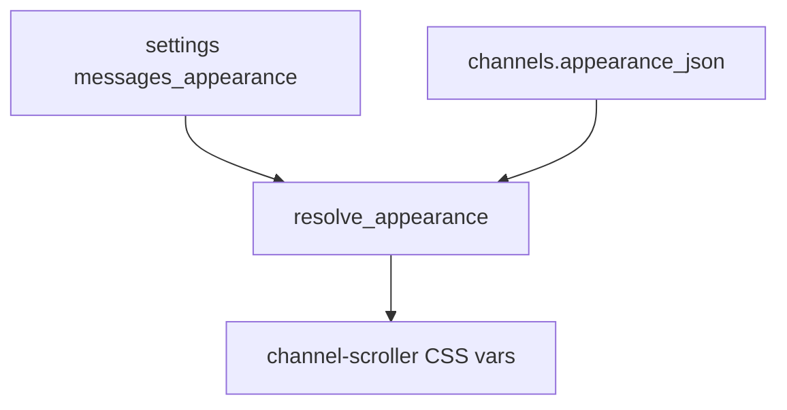

# Messages appearance (global + per-channel)

## V1 scope (locked)

- **Background:** solid or 2-stop gradient (vertical or soft diagonal), colors, opacity 0–40% (default ~20%).
- **Text:** size `sm` / `md` / `lg`; body text color (hex or theme default).
- **Not in v1:** wallpaper images, custom font files, bold/italic defaults, rich-text styles.
- HQ-local only (SQLite / settings). Never sent over mesh.



## 1. Data model

In [`src/db.rs`](src/db.rs):

- Add `channels.appearance_json TEXT` (migrate ALTER + SCHEMA).
- Global: settings key `messages_appearance` (JSON blob).
- Shared struct (serde), e.g.:

```rust
struct MessagesAppearance {
  bg_mode: Solid | Gradient, // default Solid
  bg_color: String,          // "#101418"
  bg_color_b: Option<String>, // gradient stop 2
  bg_angle: Vertical | Diagonal, // when gradient
  bg_opacity: u8,            // 0..=40
  text_size: Sm | Md | Lg,   // default Md
  text_color: Option<String>, // None = theme foreground
}
```

- Helpers: `messages_appearance()`, `set_messages_appearance()`, `channel_appearance(name)`, `set_channel_appearance(name, Option<…>)`, `resolved_appearance(channel_name) -> MessagesAppearance` (channel override fields win when present; simplest v1: whole JSON override or clear to inherit — **whole-document override** with “Reset to global”).
- Extend `ChannelRow` with `appearance_json: Option<String>` only if the list UI needs a “customized” badge; otherwise load on open only.

## 2. Apply to the thread pane

In [`src/ui/mod.rs`](src/ui/mod.rs) channel (and DM uses **global only** in v1):

- On `#channel-scroller` parent card / scroller, set inline style / CSS variables from `resolved_appearance`:
  - `--msg-pane-bg`, `--msg-pane-bg-b`, `--msg-pane-opacity`, `--msg-text-size`, `--msg-text-color`
- In [`assets/form.css`](assets/form.css):
  - `.messages-pane-themed` uses those vars for background (solid or `linear-gradient`) and message body font-size/color.
  - When themed bg opacity &gt; 0, bump bubble fill slightly (e.g. `.messages-pane-themed .message-bubble-tone-*` higher alpha) so tints stay readable.
- Header + composer stay solid (unthemed chrome).

## 3. Editors / entry points

Shared `AppearanceEditor` panel (Dialog or SlideDown):

- Mode: Solid / Gradient
- Color inputs (native `type=color` + hex field)
- Opacity slider 0–40
- Text size segmented control
- Text color (optional “Use theme default”)
- Live mini preview strip
- Save / Cancel; channel editor also **Reset to global**

**Entry points:**

1. **Messages root** (Channels tab header): gear → edits **global** appearance.
2. **Open channel header** (beside Keep): gear → edits **this channel** override.
3. **Rail:** hover action gear on channel row → same channel editor (no right-click-only path; desktop context menus are flaky).

## 4. Files

- [`src/db.rs`](src/db.rs) — column, JSON get/set, resolve
- [`src/ui/mod.rs`](src/ui/mod.rs) — editor UI, wires, scroller vars; rail gear
- [`assets/form.css`](assets/form.css) — `.messages-pane-themed` + var usage

## 5. Tests

- Round-trip global JSON; channel override then reset; opacity clamp 0–40; resolve inherits global when channel JSON null.
- `cargo check` / `cargo test` clean.
