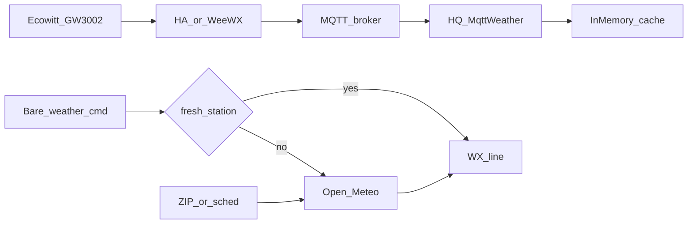

# D1c — Local MQTT weather station

## Goal

HQ can subscribe to a local MQTT broker and use a live station snapshot for **bare** `#weather` / `#wx` (and `#weather+` current frame) when the reading is fresh. Open-Meteo remains the source for ZIP/place lookups, scheduled ZIP posts, and any time MQTT is disabled/stale/unusable. Mesh lines keep the existing `WX …` shape and never stamp “Open-Meteo” or “MQTT” on air.

**Ecowitt GW3002:** supported as a **MQTT-bridged** station (Home Assistant Ecowitt integration, WeeWX, or similar publishing JSON to Mosquitto). v1 does **not** implement Ecowitt’s proprietary custom-server HTTP upload protocol.

## Behavior

- Bare `#weather` / `#wx` (no place): station cache if enabled + fresh + formattable; else Open-Meteo via existing coords resolve.
- `#weather+` with no place: station for the current/feels frame when fresh; forecast frames still Open-Meteo.
- `#weather 92345` / place / scheduled ZIPs: Open-Meteo only (unchanged).
- Freshness: `now - last_mqtt_rx <= svc_weather_mqtt_stale_secs` (default **3600**). Missing required template fields → Open-Meteo.

## Implementation

### 1. Dependency + module

- Add **`rumqttc`** to [Cargo.toml](Cargo.toml).
- New [src/services/mqtt_weather.rs](src/services/mqtt_weather.rs):
  - Load config from DB settings; password from secret file.
  - Payload modes (meshcore-bot–aligned):
    - `passthrough`: sanitize UTF-8; wrap/fit into `WX {label}: …` if needed.
    - `json_template`: allowlisted placeholders (`temperature_f`/`temperature_c`, `humidity`, `time`, `device`, dewpoint/heat index, `pressure_hpa`, rain/wind keys, etc.); accept common case variants.
  - In-memory `StationSnapshot` cache; `try_station_wx_line` / `station_is_fresh`.
- Re-export from [src/services/mod.rs](src/services/mod.rs).

### 2. Long-lived subscriber

- Run on the existing `metis-services` Tokio runtime ([src/services/poller.rs](src/services/poller.rs) / [src/main.rs](src/main.rs)).
- Connect when enabled + broker + topic set; subscribe; update cache; reconnect with backoff; pick up Settings changes on reconnect ticks.
- Cache only — no mesh publish from the subscriber.

### 3. Prefer-station insertion

- In the Wx arm of [src/radio.rs](src/radio.rs) (`handle_bot_channel`), for **empty place only**, try station before `fetch_weather_line` / `fetch_weather_detail`.
- Leave [poll_weather_zips](src/services/poller.rs) on Open-Meteo.
- Unit tests: fresh JSON → line; stale → None; ZIP path unchanged.

### 4. Secrets + settings keys

SQLite settings (defaults in `Db::ensure_defaults`):

- `svc_weather_mqtt_enabled` (default `0`)
- `svc_weather_mqtt_broker`, `svc_weather_mqtt_port` (`1883`)
- `svc_weather_mqtt_tls` (`0`), `svc_weather_mqtt_username`
- `svc_weather_mqtt_topic`
- `svc_weather_mqtt_mode` (`json_template` | `passthrough`)
- `svc_weather_mqtt_template` (default uses temp + humidity; honor F/C unit setting)
- `svc_weather_mqtt_stale_secs` (`3600`)
- `svc_weather_mqtt_label` (optional, e.g. `Yard`)

Password: **`data/mqtt-weather.pass` mode 0600** (like backup schedule passphrase) — never in settings/git.

### 5. Settings UI

Under Settings → HQ → Services in [src/ui/mod.rs](src/ui/mod.rs) (near existing weather toggles):

- Enable, broker/port/TLS/user/password, topic, mode, template, stale seconds, label.
- Status: last MQTT age / Stale / Disconnected.
- Short blurb: GW3002 needs a bridge to MQTT; HQ does not speak Ecowitt HTTP custom server.

### 6. Docs

- Check off **D1c** and MQTT success check in [todo.md](todo.md); note in [CHANGELOG.md](CHANGELOG.md).

## Out of scope (v1)

- Native Ecowitt/Ambient HTTP custom-server listener
- Multiple named station aliases (`wx patio`)
- Station data for ZIP-scheduled posts
- Publishing HQ weather to MQTT

## Verify

- Unit tests for template, stale gate, passthrough sanitize.
- `cargo test` / `cargo check` clean.
- Manual: publish Ecowitt-shaped JSON to Mosquitto → bare `#weather` uses station; age past stale → Open-Meteo; `#weather ZIP` still Open-Meteo.
