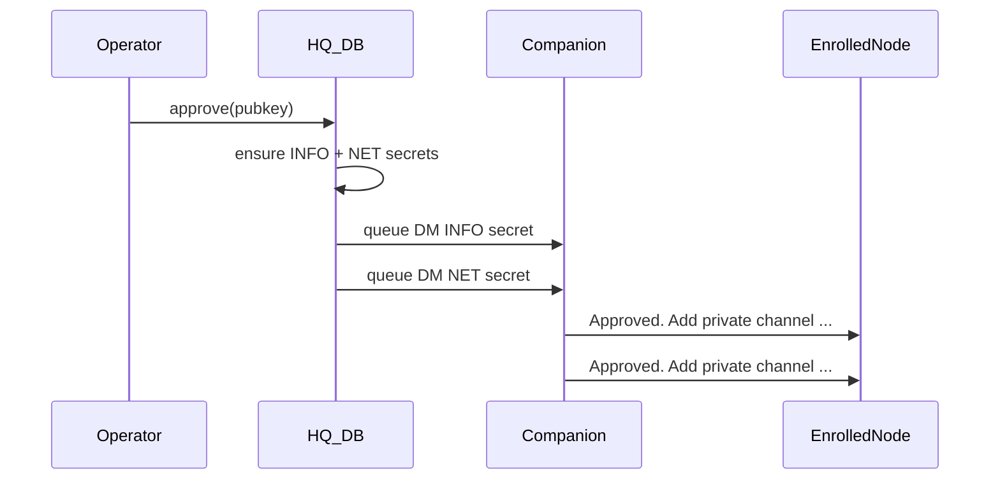

# D4: METIS-NET + renameable INFO/NET

## Decisions (locked)

- **Approve** queues **two** outbound DMs: INFO secret, then NET secret. Each uses existing `approval_message` + `[secret sent]` display. One combined DM will not fit in 160 bytes.
- **Rename** is a **live channel migrate**: same 16-byte secret, new MeshCore name. HQ renames the DB row, moves the keyring/file secret account, pushes the companion slot, and re-queues the secret under the new name to enrolled nodes. Rename does **not** rotate; revoke still rotates.
- `svc_alerts_channel` stays independent, but if it still matches the old INFO name when INFO is renamed, update it to the new INFO name.

## Current state

- Bot/home secret is hard-wired to [`CHANNEL_NAME = "METIS-INFO"`](src/secrets.rs) in approve/revoke/push/bot match ([`db::approve`](src/db.rs), [`radio::push_channel`](src/radio.rs)).
- Settings already has renameable **alerts** destination (`svc_alerts_channel`) — that is not the bot-home name.
- Manual invite already supports any private channel via [`invite_to_private_channel`](src/db.rs).

## Data model

- Settings defaults (seed in DB init like other settings):
  - `channel_info_name` → `METIS-INFO`
  - `channel_net_name` → `METIS-NET`
- Keep `CHANNEL_NAME` / add `NET_CHANNEL_NAME` as **default string constants** only; runtime paths go through helpers:
  - `Db::info_channel_name()` / `Db::net_channel_name()`
  - `Db::is_info_channel(name)` / `Db::is_net_channel(name)` / `Db::is_reserved_private(name)`
- [`ensure_default_channels`](src/db.rs): ensure Public + INFO (`role=info`) + NET (`role=net`), each private, distinct non-zero slots. Prefer existing slots; vacate conflicts the same way INFO is handled today.
- Secret accounts in keyring/file use the **current** channel names (already how `ensure_named_channel_secret` works).

## Enrollment / revoke

- Update [`approve`](src/db.rs): enroll once; insert two outbound rows; audit detail lists both names.
- Update [`revoke`](src/db.rs): rotate **both** INFO and NET secrets; re-send both to remaining enrolled; bump generation (reuse `channel_generation` or add `channel_net_generation` — prefer one shared bump + audit noting both).
- Bot commands stay INFO-only (name from setting). NET is human traffic only — no bot parse on that channel.

## Radio push / sync

- Extend connect-time [`push_channel`](src/radio.rs) (or call twice) so companion gets **both** private channels with their secrets and DB slots.
- `push_named_channel` / keep-on-radio paths treat both reserved names as HQ-owned private (do not demote to public; do not delete on cleanup).
- Channel-message bot path continues to match **INFO name only** (replace `CHANNEL_NAME` compares with `db.info_channel_name()`).

## Rename UX + logic

- Settings → Channels (near secret-store copy): two text fields — Bot home (INFO) and Peer net (NET). Defaults shown as placeholders.
- Validate: non-empty, not `Public`, INFO ≠ NET (case-insensitive), MeshCore-safe length (match existing channel name limits if any; otherwise trim and cap reasonably).
- On commit of a changed name:
  1. Load secret under old name; store under new; drop old account when possible.
  2. `UPDATE channels` rename (or delete+insert if name is PK) keeping slot/role/visibility.
  3. Update setting key.
  4. If companion connected, `PushChannel` for that slot.
  5. Queue re-send of **same** secret under new name to all `enrolled` (and do not change enrollment).
  6. If renaming INFO and `svc_alerts_channel` matched old name, set alerts channel to new name.
- UI copy: approval desk / roster revoke strings say “rotated private channels” / list configured names instead of hard-coded METIS-INFO.

## UI touchpoints

- Desk copy: approval sends both channel secrets.
- Channel list: NET appears as private peer channel; INFO remains bot home (existing badge/sort preferring INFO — extend sort so INFO then NET before others).
- Do not show secrets; keep `[secret sent]`.

## Tests / verify

- Unit: `approve` queues two outbound rows with redacted display; secrets exist for both names.
- Unit: rename migrates secret account + channel row; enrolled get re-queue under new name; alerts channel follows INFO when it matched.
- Unit: revoke rotates both and re-sends to remaining enrolled only.
- `cargo test` + `cargo check` clean (warnings as errors).

## Out of scope

- Bridging NET across HQ links.
- Changing MQTT / alert poller behavior beyond alerts-channel follow on INFO rename.
- Auto-adding NET onto every discovered radio contact.