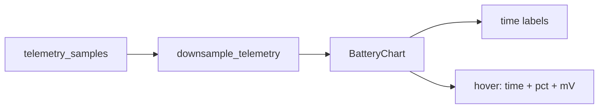

# Companion settings + battery graph polish

## Battery graph (Overview)

Today the companion card uses [`Sparkline`](src/ui/widgets.rs) with downsampled **mV only**, so timestamps and `%` are discarded in [`DashboardPage`](src/ui/mod.rs) (`downsample_avg` on `value_mv`).

**Approach:** replace the companion battery sparkline with a small interactive chart that keeps point metadata.

1. Add `downsample_telemetry(points: &[TelemetryPoint], target: usize) -> Vec<TelemetryPoint>` next to `downsample_avg` in [`src/ui/mod.rs`](src/ui/mod.rs) — average `value_mv` / `value_pct` per bucket, keep bucket midpoint `at`.
2. Add `BatteryChart` in [`src/ui/widgets.rs`](src/ui/widgets.rs) (keep plain `Sparkline` for TX/RX):
   - Plot relative-scaled mV (same as today).
   - **Bottom axis:** 3–5 minimal time labels from first/last (and mid) points using existing 12h/settings-aware time formatting from the UI.
   - **Hover:** `onmousemove` / `onmouseleave` on a wrapper; map X to nearest sample; floating tooltip with time, `pct%`, and `mV`.
   - Optional hairline + dot at the hovered index for clarity.
3. Wire it on the companion card where `Sparkline { zero_based: false }` is today; label stays “Battery voltage · last 24 hours”.

## Companion device settings (Settings page)

Apps do **not** call a cloud API; they use the Companion BLE protocol. `meshcore-rs` already exposes the pieces HQ needs; HQ currently only writes advert name + channels.

**v1 scope (curated, not full MeshCore parity):**

| Control | Mechanism |
| --- | --- |
| Refresh / list device vars | `get_custom_vars()` |
| Toggle/edit known vars when present | `set_custom_var(key, value)` with friendly labels for common keys (e.g. GPS / display / power-saving style keys when the firmware returns them) |
| Manual lat/lon | `set_coords` |
| TX power | `set_tx_power` (bounded by device max from SelfInfo / device info) |
| Send advert / flood advert | `send_advert(false/true)` |
| Reboot | `reboot` |

Unknown custom-var keys still appear as a compact key/value list so nothing is hidden; known keys get clearer labels/toggles when values look boolean (`0`/`1`, `on`/`off`).

### Radio layer ([`src/radio.rs`](src/radio.rs))

- Extend `RadioStatus` with `custom_vars: HashMap<String, String>` (and keep existing `firmware` / `model` / battery fields).
- On session ready (after first battery), call `get_custom_vars` and store on status; also refresh after successful sets.
- Add `RadioCmd` variants + `RadioHandle` methods: `RefreshDeviceSettings`, `SetCustomVar { key, value }`, `SetCoords { lat, lon }`, `SetTxPower(u8)`, `SendAdvert { flood }`, `Reboot`.
- Handle them in the live session `select!` arm (same command-lock pattern as `ApplyName`), update `detail` / vars on success or error.

### UI ([`src/ui/mod.rs`](src/ui/mod.rs) Settings)

- New card **“Device settings”** under Companion radio, enabled only when `radio.state == "connected"`.
- Sections: Location (`set_coords` + show current adv lat/lon), Radio (`tx` + Send advert / Flood advert), Power (Reboot with confirm), Custom vars (list + edit/toggle + Refresh).
- Disabled / explanatory copy when disconnected.

No new deps; reuse existing Settings form controls and [`assets/form.css`](assets/form.css) only if tooltip/axis need a couple of non-Tailwind classes.

## Out of scope for this pass

- Full MeshCore Open settings parity / firmware OTA.
- Hover tooltips on Mesh activity `LineChart` (battery only).
- Changing battery poll interval (already fixed with persistent `interval`).
