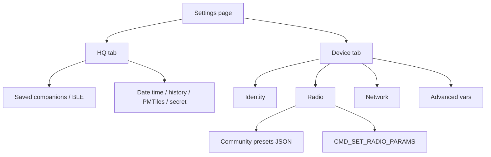

# Device settings parity (MeshCore-aligned)

## Docs / GitHub (your question)

Yes — MeshCore publishes this openly (not behind meshcore.io alone):

| Source | What it covers |
| --- | --- |
| [github.com/meshcore-dev/MeshCore](https://github.com/meshcore-dev/MeshCore) | Firmware + `docs/` |
| [docs.meshcore.io](https://docs.meshcore.io/) / [meshcore-dev.github.io/meshcore](https://meshcore-dev.github.io/meshcore/) | Hosted docs |
| [`docs/companion_protocol.md`](https://github.com/meshcore-dev/MeshCore/blob/main/docs/companion_protocol.md) | BLE companion commands/responses (app ↔ radio) |
| [`docs/cli_commands.md`](https://github.com/meshcore-dev/MeshCore/blob/main/docs/cli_commands.md) | Full `get`/`set` CLI surface (radio, GPS, path.hash, regions, …) — mainly repeaters/rooms but many prefs overlap companions |
| [`examples/companion_radio/MyMesh.cpp`](https://github.com/meshcore-dev/MeshCore/blob/main/examples/companion_radio/MyMesh.cpp) | Exact binary handling for `CMD_SET_RADIO_PARAMS`, TX power, etc. |
| [meshcore.js Radio API](https://meshcore.js.org/docs/client/reference/classes/Radio) | How the official web/app wraps the same commands |

There is **no single “every MeshCore app settings screen” JSON** from MeshCore HQ; the authoritative lists are **companion protocol + CLI docs + firmware prefs**. The mobile/web UI is a curated subset of those.

**Radio params frame** (`CMD_SET_RADIO_PARAMS` = 11): `freq_u32` (MHz×1000), `bw_u32` (kHz×1000), `sf`, `cr`, optional `repeat` (fw 9+). Valid ranges match firmware checks. `meshcore-rs` 0.2 defines the opcode but **does not expose** `set_radio_params`; HQ will send the frame via the existing command sender / a small local helper.

## Goal for this implementation pass

Ship MeshCore-comparable **device configuration** in HQ (Identity + Radio presets + Network + Advanced vars). **Defer** map/RF Tools (trace, noise floor, Rx log, coverage) and Extra Tools (import/export config, factory reset, in-app CLI) to a later pass — those are separate product surfaces, not the Settings screens you highlighted.

## UI structure

Refactor [`SettingsPage`](src/ui/mod.rs) into two top-level tabs:

1. **HQ** — current pairing, advert name (or move advert name into Device Identity), date/time, channel secret label, history, PMTiles.
2. **Device** — only meaningful when `radio.state == "connected"`; otherwise show connect CTA.

Device sub-tabs:

- **Identity** — advert name (reuse `apply_name`), public key (from HQ save / SelfInfo already stored via `save_hq`), lat/lon (`set_coords`), read/display `adv_loc_policy`; Share Position mapped to the firmware policy when a dedicated set exists, otherwise surface via custom vars / documented CLI-equivalent keys after a live `get_custom_vars` dump.
- **Radio** — current freq/BW/SF/CR/TX from SelfInfo (already parsed into HQ JSON on connect), **Choose preset** dialog (searchable list), custom editors, TX power, Enable repeat (repeat byte on `SET_RADIO_PARAMS`), Apply + note that some firmwares want reboot.
- **Network** — Default region / flood scope via `set_flood_scope`; path-hash size via custom var / prefs key when present (`path.hash.mode`-style).
- **Advanced** — existing custom-vars list/toggles/Refresh (move current Device settings card content here).

Keep visual language consistent with existing Settings cards; use [`assets/form.css`](assets/form.css) for tab strip if Tailwind arbitrary utilities are missing.

## Radio presets

Add [`assets/radio_presets.json`](assets/radio_presets.json) (or `src/radio_presets.rs` `include_str!`) with the community list from MeshCore UI, including:

- USA/Canada (Recommended): `910.525 / SF7 / BW62.5 / CR5`
- USA/Canada (Alternate), NZ, EU-style entries from the screenshot list

Preset picker: dialog with search filter; selecting fills drafts and can Apply immediately. Mark matching preset as “Custom” when values don’t match.

## Radio / BLE layer ([`src/radio.rs`](src/radio.rs))

- Extend `RadioStatus` with live radio fields already known from SelfInfo: `radio_freq`, `radio_bw`, `radio_sf`, `radio_cr`, `adv_loc_policy`, `public_key` (hex), `client_repeat` if known; populate on `send_appstart` (today only lat/lon/tx/max are kept on status — freq/sf/etc. go to DB JSON only).
- Add `RadioCmd::SetRadioParams { freq_mhz, bw_khz, sf, cr, repeat }` + handle method that builds CMD 11 and awaits OK (same lock pattern as `SetTxPower`).
- Wire `SetFloodScope(Option<String>)`.
- After successful radio-param apply, update status fields and detail string; offer reboot via existing `Reboot` cmd.

## Files to touch

- [`src/ui/mod.rs`](src/ui/mod.rs) — Settings tab IA; Device Identity / Radio / Network / Advanced panels; preset dialog.
- [`src/radio.rs`](src/radio.rs) — status fields + `SetRadioParams` / `SetFloodScope`.
- New presets asset + small parse helper.
- [`assets/form.css`](assets/form.css) — settings tab styles (and remember boot CSS is `include_str!`’d in [`src/main.rs`](src/main.rs)).

## Explicitly out of this pass

- Tools nav (trace path, coverage, LoS, Rx log, discover, noise floor).
- Import/export config, factory reset, Bug reporting, Debug logs, in-app Command Line.
- Upstream patch to `meshcore-rs` (local frame send is enough).
