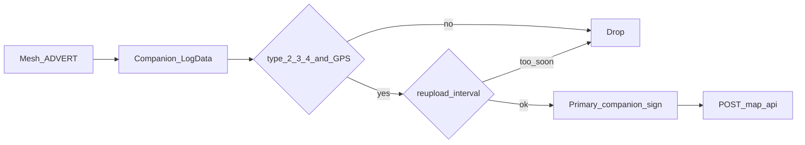

# E4 — map.meshcore.dev uploader

## Goal

When enabled, HQ uploads **infra ADVERTs with valid GPS** to [map.meshcore.dev](https://map.meshcore.dev) so the community map can show repeaters / rooms / sensors HQ hears. Default **off**. Never upload companions/CHAT, Tracker trails, or HQ site pins. Signing is **operator-gated** and uses the primary companion — **no private key in SQLite, keyring, or backup**.

## Protocol (match meshcore-bot / RT)

- Endpoint default: `https://map.meshcore.dev/api/v1/uploader/node`
- Body JSON:
  - `data`: compact string `{"params":{"freq", "cr", "sf", "bw"},"links":["meshcore://<raw_hex>"]}`
  - `signature`: hex Ed25519 over **SHA-256** of that `data` string
  - `publicKey`: hex of primary companion pubkey
- `params` from primary `SelfInfo` (same scale as RT: freq/bw as reported by companion — verify once in dry-run logs)
- Skip: `contact_type` / advert type **1 (CHAT)**; missing or `(0,0)` coords; same pubkey inside `min_reupload_interval` (default **3600** s)

## Capture path (new)

Companion summarized `EventType::Advertisement` is **not enough** (prefix/name/lat/lon only — no raw packet).

1. When upload is enabled, also subscribe to `EventType::LogData` on each connected radio session ([src/radio.rs](src/radio.rs) subscribe list ~3150).
2. On `LogData` with `PayloadType::Advert` + `RawAdvertisement` with GPS:
   - Rebuild the on-air mesh packet bytes from `MeshPacketHeader` + inner `payload` (header byte, optional transport code, path byte + path, then advert payload). Unit-test round-trip against `parse_mesh_packet_header`.
   - Hex → `meshcore://…` link.
3. Filter advert type ∈ {2,3,4} (repeater/room/sensor). Do **not** require `claimed_infra` (matches bot + todo wording); claimed list is unrelated to what air carries.
4. Enqueue upload job (channel to services runtime) — do not block the radio select loop on HTTP.

## Signing (operator-gated, no key storage)

1. Settings enable alone is not enough: require an explicit **Authorize** action (“Use primary companion to sign map uploads. Private key stays on the radio.”).
2. Prefer primary companion `Commands::sign(sha256(data))` via existing [meshcore-rs](https://crates.io/crates/meshcore-rs) API (`sign` / `sign_start`/`sign_data`/`sign_finish`). Never call `export_private_key` into durable storage.
3. If firmware returns Disabled / sign fails: leave upload unauthorized, surface status (“companion cannot sign — enable private-key/sign support in firmware”).
4. Pubkey for the POST = primary companion identity already known after connect (`SelfInfo.public_key`).
5. Audit: `svc_map_upload_auth` / successful uploads (pubkey prefix + HTTP result) — never log signature or key material ([src/app_log.rs](src/app_log.rs) already redacts “private key”).

If radio `sign()` turns out to wrap data differently than the map API expects, fall back to a **RAM-only** one-shot `export_private_key` held in process memory while authorized (cleared on disable / disconnect / exit) — still never written to DB/backup. Prefer on-radio sign first in implementation order.

## Service module

New [src/services/map_upload.rs](src/services/map_upload.rs):

- Config from settings; in-memory last-upload map `pubkey → last_advert_ts` (cap ~5k; prune older than `2 × interval`)
- `try_enqueue` from radio LogData path; worker on `metis-services` Tokio runtime ([src/services/poller.rs](src/services/poller.rs)) posts via `ureq`/`http_get`-style client (POST JSON, 15s timeout)
- `dry_run` setting: log would-be payload (redacted) without POST
- Status line for Settings: Off / Need authorize / Idle · last upload / Error · …

Re-export from [src/services/mod.rs](src/services/mod.rs).

## Settings

Under Settings → HQ → **Data** (phase E home; not Services weather):

- `svc_map_upload_enabled` (default `0`)
- `svc_map_upload_authorized` (default `0` — set only by Authorize button)
- `svc_map_upload_api_url` (default map.meshcore.dev endpoint)
- `svc_map_upload_interval_secs` (default `3600`)
- `svc_map_upload_dry_run` (default `1` until first successful live test locally; ship default `0` only if dry-run is clearly labeled — **ship default dry_run `0` with enabled `0`**, so turning on without authorize still does nothing; Authorize + enabled required for live POST)

UI copy: infra GPS adverts only; companions/tracks/site pins stay local; needs internet; signing on primary companion.

Defaults in `Db::ensure_defaults` ([src/db.rs](src/db.rs)).

## Docs / verify

- Check off **E4** + success check in [todo.md](todo.md); note in [CHANGELOG.md](CHANGELOG.md)
- Unit tests: packet rebuild; filter CHAT / 0,0; rate-limit gate; JSON compact shape
- Manual: dry-run LogData advert → status; authorize + enable → HTTP 2xx on map API; companion type 1 never queued

## Out of scope

- Uploading Tracker trails, site pins, or companions  
- Storing MeshCore private keys on disk  
- Custom self-hosted map servers beyond editable `api_url`  
- F4 `radio_id` ingest tagging (separate todo)
