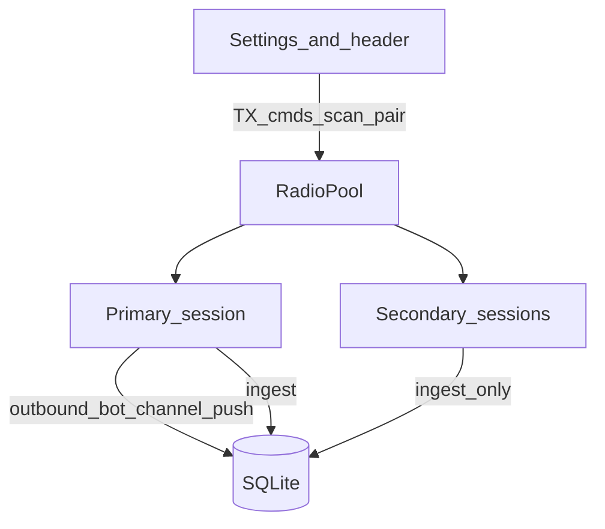

# F1–F3: USB + multi-radio pool + primary companion

## Locked defaults

- Pin `meshcore-rs` as `default-features = false, features = ["ble", "serial"]` (today HQ lists only `ble` but crate defaults already pull serial/tcp; make the intent explicit and drop unused `tcp`). Connect USB with `MeshCore::serial(port, 115200)` — no PIN.
- Port listing is **not** in meshcore-rs; add a direct `serialport` (or re-export) dependency and filter to USB CDC/ACM (skip Bluetooth RFCOMM). Prefer stable `/dev/serial/by-id/…` when present.
- Every attached companion-protocol device runs the **same session pipeline** (appstart → contacts → channels → drain → subscribe) for **ingest**.
- Only the **primary** radio (role `companion`) owns: enrollment/secret DMs (`outbound` flush), bot channel replies, operator channel/DM/CLI sends, channel secret push, flood-scope apply used by HQ services.
- Secondary radios: ingest + device query/battery/status only; **do not** flush `outbound`, **do not** run bot handlers, **do not** accept UI TX cmds.
- Defer full **F4/F5** polish. Messages already store `radio_id`; `dedupe_key` is radio-agnostic so the same air frame heard twice should not double-insert.

## Current state

- Single task: [`spawn_radio`](src/radio.rs) → one `RadioHandle` + one `RadioStatus`; connect path is **`MeshCore::ble_connect` only** (custom `discover_radios` + `ble_pair`, not library `ble_discover`).
- `radios` table already has `(transport, address)` unique + `list_saved_radios`; `remember_radio` overwrites global `radio_name`.
- Global `RADIO_CMD_TX` fans services/UI into that one handle — must become **primary-targeted**.
- Schema already tags `messages.radio_id` on ingest; no pool/primary/USB UI yet.

## Architecture

### RadioPool (replace single handle)

- New types in [`src/radio.rs`](src/radio.rs) (or `src/radio/pool.rs` if the file split helps):
  - `RadioId` = DB `radios.id`
  - `RadioSlot { id, transport, address, role, status, handle }`
  - `RadioPool` with `Arc` shared state: map of slots, `primary_id: Option<i64>`, cmd routing
- `spawn_radio_pool(...)` from [`main.rs`](src/main.rs) instead of `spawn_radio`.
- Each slot: own Tokio task (or one runtime with N session tasks), own `stop` watch, own `RadioStatus`.
- Keep a thin facade so existing UI call sites (`state().radio.disconnect()`, `send_channel`, …) route to **primary**; add explicit APIs for per-slot connect/disconnect/scan.

### Transport

| | BLE | USB |
|---|---|---|
| Discover | existing scan | `tokio_serial` / `serialport::available_ports()` filtered to USB serial (ignore Bluetooth RFCOMM) |
| Connect | pair PIN + `ble_connect` | `MeshCore::serial(path, 115200)` — no PIN |
| Address key | BLE name/addr as today | prefer `/dev/serial/by-id/...` when present, else device path |
| `radios.transport` | `ble` | `usb` |

Share one `run_session(...)` after connect; branch only in connect/discover/error classification (`is_ble_link_error` vs serial disconnect).

### Roles + primary (F3)

- Settings / DB: `radios.role` ∈ `companion` | `room` | `repeater` | `other` (default `companion` for BLE and first USB).
- Setting `primary_radio_id` (i64). On connect: if unset and role is companion, become primary; if primary disconnects, auto-promote another connected companion (deterministic: lowest id).
- Operator can set primary in Settings (companion-only).
- Session flag `is_primary` gates:
  - `flush_one_outbound`
  - bot parse / `enqueue_channel_text` path
  - `push_channel` / secret rotate push
  - accepting `SendChannel` / DM queue from UI

Secondary still: contact sync, message ingest with `radio_id`, battery/self-info into that row’s `device_json`.

## UI

- **Settings → Connect**: list slots (transport badge, address, role select, connected/battery, Connect/Disconnect). USB port dropdown + Refresh. BLE scan list unchanged.
- **Header**: show primary name/battery; if N>1, subtle “+N” or compact multi status — avoid a second full control strip.
- Desk/copy: enrollment and bot still described as HQ companion; no change to approve semantics.

## Files to touch

- [`Cargo.toml`](Cargo.toml) — pin `meshcore-rs` `ble`+`serial`; add `serialport` for discover
- [`src/radio.rs`](src/radio.rs) (+ optional split) — pool, USB discover/connect, primary gates
- [`src/db.rs`](src/db.rs) — `role`, `primary_radio_id` helpers; stop clobbering single `radio_name` as sole identity
- [`src/main.rs`](src/main.rs) — spawn pool; services keep using facade
- [`src/ui/mod.rs`](src/ui/mod.rs) — Connect tab multi-radio + USB; header primary snapshot
- [`src/services/`](src/services/) — channel enqueue via primary only (through existing radio cmd bridge)

## Tests / verify

- Unit: primary promotion when primary drops; non-primary rejects TX cmd (or no-ops with clear error).
- Unit: USB address prefers `by-id` when both paths given.
- `cargo test` + `cargo check` clean.
- Manual: BLE primary + USB second (or two USB): both ingest; `#weather` / approve DM only on primary air.

## Out of scope (this slice)

- F4 map/roster “heard on radio X” UI and advanced cross-radio contact merge rules beyond existing pubkey upsert + message dedupe.
- F5 full per-device auto-reconnect policy UI (basic reconnect-on-drop for non-operator-disconnect can mirror today’s BLE backoff on each slot).
- TCP transport.
- Changing room-server firmware protocols beyond companion serial/BLE.