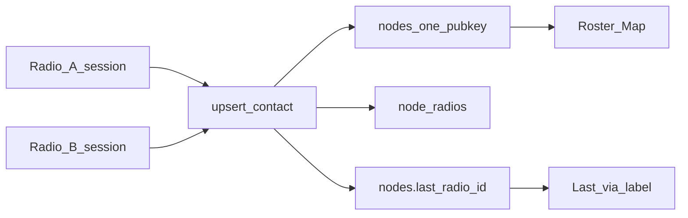

# F4 — Contact/message ingest tagged by radio_id

## Already done (leave alone)

- `messages.radio_id` is written on all RX/TX inserts from the session radio id (`handle_event`, `on_direct`, channel/DM TX in [src/radio.rs](src/radio.rs)).
- Message dedupe stays radio-agnostic ([src/path.rs](src/path.rs) `dedupe_key` = kind|sender|timestamp|text) so the same air frame on two companions is one row.
- `nodes` stay `PRIMARY KEY (pubkey)` — roster/map already one row / one pin per identity.

## Gap

Contact ingest (`Db::upsert_contact` in [src/db.rs](src/db.rs) ~1762) has no `radio_id`. Sync/discover call sites do not pass the session radio. Global `contacts_since` can make radio B skip a dump after radio A advances the watermark.

## Approach



### 1. Schema

In [src/db.rs](src/db.rs):

- Add `nodes.last_radio_id INTEGER` (nullable) via SCHEMA + ALTER migration in `Db::from_conn`.
- Add junction:

```sql
CREATE TABLE IF NOT EXISTS node_radios (
  pubkey TEXT NOT NULL,
  radio_id INTEGER NOT NULL,
  last_heard INTEGER NOT NULL,
  PRIMARY KEY (pubkey, radio_id)
);
```

No second node row per radio. No change to message dedupe or messages schema.

### 2. DB API

- Extend `upsert_contact(..., radio_id: Option<i64>)`: if `Some(id)`, set `nodes.last_radio_id` and upsert `node_radios`.
- Helpers: `touch_node_radio(pubkey, radio_id)`, `list_node_radios(pubkey)`, resolve label from `radios`.
- Extend `NodeRow` + `map_node` with `last_radio_id: Option<i64>`.
- On message RX that already calls `touch_last_heard`, also `touch_node_radio` with the session `radio_id`.

### 3. Radio session wiring

In [src/radio.rs](src/radio.rs):

- Pass session radio id into every `upsert_contact` (contact sync ~3914, discover ~1781).
- Replace global-only `contacts_since` with per-radio key `contacts_since_{radio_id}` in sync/retry/bootstrap. If per-radio key missing and global `contacts_since` exists, seed from global once (no full-dump surprise on upgrade).

### 4. UI (thin)

- Roster node detail in [src/ui/mod.rs](src/ui/mod.rs): `Last via {label}`; if multiple `node_radios`, short Also heard on line.
- Map pin props in [src/ui/map_page.rs](src/ui/map_page.rs): same `last_radio` label in existing popup data.
- Do not change `list_nodes` cardinality, map feature count, or Overview heard totals.

### 5. Docs / verify

- Check off F4 in [todo.md](todo.md); note in [CHANGELOG.md](CHANGELOG.md).
- Unit tests: same pubkey from two radios → one nodes row, two node_radios, last_radio_id = latest; cross-radio message still deduped; per-radio contacts_since independent.
- `cargo test` / `cargo check` clean.

## Out of scope

- Including radio_id in message dedupe (would double-count).
- Per-radio roster/map lists.
- F5b USB sticky identity.
- Message-list filter by radio (existing column can power that later).
