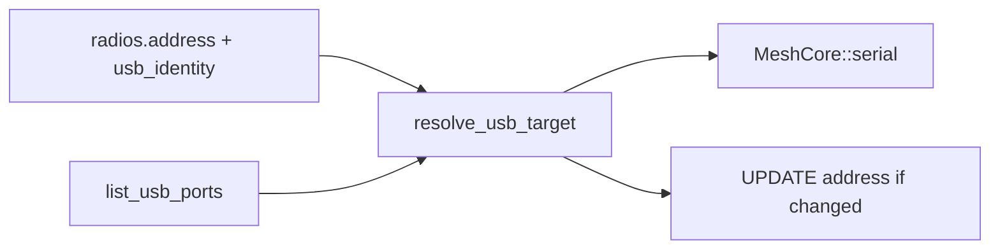

# F5b — USB sticky port / serial identity

## Problem

Connect already prefers Linux `/dev/serial/by-id/…` via [`src/usb_serial.rs`](src/usb_serial.rs), but reconnect and the slot loop still treat `radios.address` as a fixed open path:

- [`reconnect_saved`](src/radio.rs) opens the stored address verbatim.
- [`slot_loop`](src/radio.rs) reconnects to the same `SlotCtx.address`.
- `is_fatal_usb_session_error` treats `no such file` as terminal, so a renumbered `ttyACM*` / `COM*` / missing by-id symlink ends the slot.
- Windows and macOS have no by-id; COM / `cu.usbmodem*` paths change after unplug/replug.
- Legacy rows may still store ephemeral paths even on Linux.

F4 tagged ingest by `radio_id`, so remapping must **update the same radio row**, not insert a second USB radio.

## Approach

Persist a sticky USB identity beside the open path. On every USB open (operator connect, reconnect, slot backoff), rescan ports, match identity (or by-id equivalence), open the current path, and rewrite `radios.address` when it changed.

Identity format (single string): `vid:04x:pid:04x:sn:<serial>` when `UsbPortInfo.serial_number` is present; otherwise `vid:04x:pid:04x` and only rematch when **exactly one** scanned port shares that VID/PID. Two matches = ambiguous, do not guess.

## Changes

### 1. [`src/usb_serial.rs`](src/usb_serial.rs) — identity + resolve

- Extend `UsbPort` with `identity: Option<String>` filled from `SerialPortType::UsbPort`.
- Add `usb_identity_key(info) -> Option<String>`.
- Add `resolve_usb_target(saved_address, saved_identity, ports) -> Result<&UsbPort, String>` match order:
  1. Exact `path` or `system_path`
  2. Linux: saved by-id leaf equals a live by-id leaf (symlink may point at a new tty)
  3. Unique `identity` match
  4. Else error: not found / ambiguous
- Keep existing by-id preference in `list_usb_ports` / `normalize_usb_address`.
- Unit tests with synthetic `UsbPort` lists (exact, identity remap, ambiguous VID/PID, by-id leaf).

### 2. [`src/db.rs`](src/db.rs) — column + remap helpers

- Migrate `radios`: add `usb_identity TEXT NOT NULL DEFAULT ''`.
- Extend USB remember path to persist identity (empty for BLE/TCP).
- Add `set_radio_usb_identity(id, identity)`.
- Add `remap_radio_address(id, new_address)`:
  - Update address on the live `id` (preserves F4 `radio_id` links).
  - On `UNIQUE(transport, address)` conflict with another USB row: keep the live slot id; forget the stale duplicate address row.
- Surface `usb_identity` on saved-radio list rows used by reconnect.

### 3. [`src/radio.rs`](src/radio.rs) — resolve on open + recoverable missing device

- `connect_usb_now`: after normalize/list match, persist identity into remember/start.
- `reconnect_saved` for USB: refresh port list, `resolve_usb_target`, remap DB address if needed, then `start_slot` with resolved path + label.
- USB `slot_loop`: before each `run_session` connect, load address + identity from DB, rescan, resolve, optionally remap, then open the resolved path (do not rely on a frozen `SlotCtx.address` alone).
- Soften USB fatal handling: remove bare `no such file` / `not found` from terminal failures when the operator did not disconnect. Treat as `SessionEnd::Lost` with backoff (“USB companion not found; waiting for the same device…”). Keep permission / sharing / SelfInfo protocol failures fatal.
- Clarify connect error text to mention sticky rematch; Refresh ports remains available.

### 4. Docs / todo

- Check off **F5b** in [`todo.md`](todo.md).
- Short [`CHANGELOG.md`](CHANGELOG.md) note: USB reconnect follows USB serial identity / by-id across renumeration.

## Out of scope

- No new Settings chrome beyond the existing USB port list.
- No BLE sticky changes; TCP stays host:port.
- No guessing when two identical VID/PID devices lack serials.
- Firmware flasher keeps using `list_usb_ports` as-is (one-shot; pool is the sticky consumer).

## Verify

- Unit: resolve exact / identity remap / ambiguous / by-id leaf.
- DB: `remap_radio_address` keeps the same `id`.
- `cargo test` + `cargo check` clean (warnings as errors).
- Manual when hardware available: save USB companion, unplug/replug so tty/COM changes, confirm auto-reconnect without a new `radio_id`.
