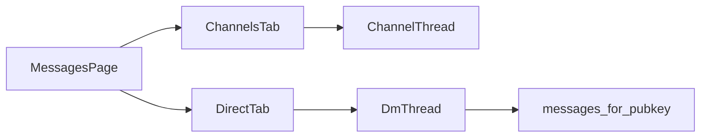

# Firmware interval, badges, Inbox copy, DM threads

## 1. Firmware: interval-only sync + picker

**Bug:** [`spawn_sync_loop`](src/firmware.rs) always calls `start_sync` after the 8s delay, then sleeps the interval. It ignores `firmware_last_sync_at` / `last_ok_at`.

**Fix in** [`src/firmware.rs`](src/firmware.rs):
- After the startup delay, sync **only if** enabled **and** (`last_ok_at == 0` **or** age ≥ `sync_interval_secs`).
- Then sleep in shorter slices (e.g. 60s), re-check enabled + due — so changing the interval in Settings applies without restart.
- Keep **Sync now** as the only forced path.

**UI in** Flasher settings ([`src/ui/mod.rs`](src/ui/mod.rs) ~6740):
- Replace fixed “every 12 hours” checkbox copy with enable toggle + `<select>`: **12 hours** / **1 day** / **30 days**.
- Persist `firmware_sync_interval_hours` as `12` | `24` | `720` (setting already read by `sync_interval_secs`; default stays 12).

## 2. Inbox wording

Refresh [`InboxPage`](src/ui/mod.rs) copy (title + blurb + empty state). Keep the same two sections (pending signups + held service alerts). Suggested voice:

- Title: **Inbox** (drop “Signup inbox”)
- Blurb: Operator queue for join requests and held community alerts. A node DMs `signup` to ask to join; approval sends the bot-home and peer-net secrets. Weather/Amber/etc. wait here when auto-relay is off. Ordinary DMs live under Messages → Direct.
- Empty: “No pending join requests.”

Nav label stays **Inbox**; badge = pending signups + pending service events.

## 3. Nav badges (Inbox / Roster / Messages×2)

[`NavButton`](src/ui/mod.rs) today: expanded = no numeric badge; collapsed = 2px dot only. Inbox already passes `badge: pending`.

**Upgrade `NavButton`:**
- Support one or two numeric badges (pill with count, `99+` cap).
- Show in both expanded and collapsed modes (collapsed: absolute corner pills on the icon).

**Counts (recomputed each UI tick):**
| Nav | Badge(s) |
|---|---|
| Inbox | `pending_nodes + pending_service_events` |
| Roster | count of unnoticed newly heard nodes (below) |
| Messages | **two** badges: channel unread sum + DM unread sum |

Channel unread already exists via `channel_last_read_*` / `list_channels().unread_count`. Add a DB helper `total_channel_unread()`.

## 4. Roster: NEW pill on newly heard devices

Nodes have no first-seen/notice flag today; bulk contact sync would flood if every INSERT were “new”.

**Schema** ([`src/db.rs`](src/db.rs)):
- `ALTER TABLE nodes ADD COLUMN noticed INTEGER NOT NULL DEFAULT 1` (existing rows stay noticed).
- New live inserts that should alert the operator set `noticed = 0`.
- Contact **bootstrap/sync** upserts keep `noticed = 1` (pass a `mark_unnoticed: bool` / quiet flag on insert paths used by `get_contacts`).
- Live paths (new advert / first DM from unknown / import that is truly new after HQ is up) set `noticed = 0`.

**API:** `count_unnoticed_nodes()`, `mark_node_noticed(pubkey)`, optionally `mark_all_noticed()` if useful.

**UI:** On Roster list rows, if `!noticed`, show a compact pill: white text, red background, label `NEW`. Opening that node’s detail calls `mark_node_noticed` and clears the pill + nav badge.

## 5. Messages: Channels | Direct (card per contact)

**DB (mirror channel read cursors):**
- Settings key `dm_last_read_{pubkey}` (message id), same pattern as `channel_last_read_{slot}`.
- `list_dm_threads()` → contacts with ≥1 `kind='direct'` message: pubkey, name, last preview, `unread_count`, last_at.
- `dm_unread_total()`, `set_dm_last_read`, mark caught-up when thread opened / scrolled (same behavior as channels).
- Tighten `messages_for_pubkey` to `kind = 'direct'` (and both directions) so the thread is DM-only.

**UI** ([`MessagesPage`](src/ui/mod.rs)):
- Top subtabs: **Channels** | **Direct**, each with its unread badge.
- Direct list: one card/row per contact (parity with channel list: name, preview, unread badge).
- Selecting a contact opens the existing-style message pane + composer that queues a DM (`queue_text` / current Roster Send DM path) instead of channel send.
- Keep channel unread banner / last-read behavior as-is under the Channels tab.

Enrollment desk behavior unchanged: `signup` / `status` still handled in `on_direct`; those messages still appear in the DM thread for that contact.

## 6. Verify

- Unit tests: interval due/skip helper; noticed default on migrate vs new insert; dm thread unread math.
- `cargo test` / `cargo check`, no warnings.
- Light note in [`todo.md`](todo.md) only if you want this tracked as a checkbox later (skip unless you ask).
