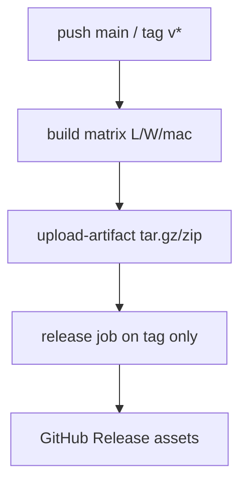

# H1 — Standalone desktop ship (fix CI + release)

## What’s broken today

[`.github/workflows/build.yml`](.github/workflows/build.yml) already builds three platform artifacts and has a `release` job, but:

1. **Builds fail** on `main` (recent runs), so artifacts/releases never complete.
2. **No `v*` tags** exist on the repo, so the release job (`if: startsWith(github.ref, 'refs/tags/v')`) never runs even when builds were green earlier.

Observed failures from run `41541656835`:

| Runner | Failure |
| --- | --- |
| Linux | `libudev-sys` — missing `libudev` pkg-config (`libudev-dev` not in apt list) |
| Windows | [`src/usb_serial.rs`](src/usb_serial.rs) test `prefer_by_id_when_both_paths_given`: second `std::os::unix::fs::symlink` is **not** behind `#[cfg(unix)]` (compile error) |
| macOS | `backup::tests::round_trip_backup_restore` → `Msg("not an error")` from SQLite backup; root cause is racey temp path in [`Db::sqlite_snapshot_bytes`](src/db.rs) using `pid + unix_now()` (second resolution) under parallel tests |

Ship path stays **`cargo build --release`** (already CI). MapLibre/CSS are already pulled in via `asset!()`; no switch to `dx bundle`/installers in this slice.

## Fixes (CI must go green first)

### 1. Linux deps — [`.github/workflows/build.yml`](.github/workflows/build.yml)

Add `libudev-dev` to the apt install list (needed by `serialport` → `libudev-sys`). Mirror in [README.md](README.md) Linux packages.

### 2. Windows compile — [`src/usb_serial.rs`](src/usb_serial.rs)

Wrap the whole by-id symlink test body after the first `#[cfg(unix)]` create (including the second symlink) in `#[cfg(unix)]`, or gate the second `symlink` the same way. Non-unix keeps the early return.

### 3. Backup flake — [`src/db.rs`](src/db.rs)

Make snapshot/restore temp files unique with nanoseconds or an atomic counter, e.g. `metis-snap-{pid}-{nanos}.db` (same for restore). Prevents parallel tests from clobbering one SQLite backup file and surfacing SQLITE_OK as `"not an error"`.

### 4. Release publishing

Workflow already correct for tags. After green CI:

- Document in README: tag and push (`git tag v0.1.0 && git push origin v0.1.0`) to publish a GitHub Release with the three archives.
- Keep `softprops/action-gh-release` + `contents: write` as-is.
- Do **not** auto-release every `main` push (noise); tags are the release gate.

Optional hardening in the same PR: on tag builds, name artifacts with the tag (`metis-mesh-hq-linux-x86_64-v0.1.0.tar.gz`) via `${{ github.ref_name }}` so Releases are unambiguous.

## Docs (H1 deliverable)

Update [README.md](README.md) “Build releases yourself” / new **Install** section:

- Download the archive for your OS from the GitHub Release (or Actions artifacts).
- Unpack; run the binary from a folder you own.
- First launch creates `./data/` (cwd-relative; `METIS_DATA_DIR` overrides) for SQLite, firmware cache, backups.
- Linux: note WebKitGTK runtime packages (not only `-dev`) needed to **run** the shipped binary.
- Windows/macOS: WebView2 / system WebKit as applicable (brief).
- Point operators at tagging for releases.

Check off **H1** in [`todo.md`](todo.md); short [`CHANGELOG.md`](CHANGELOG.md) note.

## Out of scope (later H2/H3)

- Full manual smoke on each OS beyond CI green (H2).
- WAL pragma assertion / checkpoint docs beyond what’s already true in `Db::open` (H3).
- `dx bundle` `.dmg`/`.msi`/AppImage packaging.
- Code-signing / notarization.

## Verify

- Local: `cargo test` / `cargo check` clean (incl. Windows-gated USB test shape).
- CI on `main`: Linux, Windows, macOS jobs green; artifacts upload.
- Tag `v0.1.0` (or next) → Release job attaches three archives; README matches the flow.
