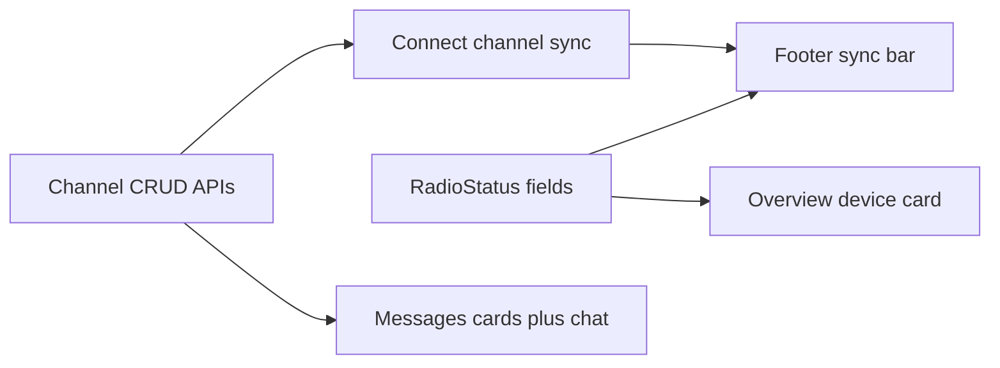

# HQ Overview, Sync Status, and Channel Messages

Those compile warnings are the smoking gun: [`ChannelRow`](src/db.rs) and `MessageRow.channel_idx` were added for the Messages redesign but never used by UI or list APIs. Messages is still a flat traffic table; Overview only shows a thin Headquarters reconnect card; connect sync runs quietly after the footer already says Connected.

## Scope (in build order)

### 1. Expand live radio status (foundation)

Update [`RadioStatus`](src/radio.rs) beyond `state` / `detail` / `connected_name`:

- `sync_phase`: idle | connecting | appstart | contacts | channels | messages | ready
- `sync_label`: human text for the footer
- `sync_progress`: `Option<(u32, u32)>` for determinate steps when known (e.g. channel slot `i` of `max`), else indeterminate
- `battery_pct: Option<u8>`, `battery_mv: Option<u16>` via meshcore `BatteryInfo::percentage()`
- `firmware` / `model` strings from device query
- `hq_lat` / `hq_lon`: `Option<f64>` from appstart / `db.hq_position()`

Instrument [`run_session`](src/radio.rs): write phases around appstart, device query, `sync_contacts`, radio channel pull, `push_channel`, queued `get_msg` drain; refresh battery about every 30s in the live loop; keep `detail` as the short connected summary (name + battery %).

### 2. Bottom status bar progress

In the app footer in [`src/ui/mod.rs`](src/ui/mod.rs) (~215–220):

- Left: connection icon + label (existing)
- Center/right: thin progress track (determinate when `(done,total)` set; animated indeterminate otherwise) + `sync_label` / `detail`
- Hide the bar fill when `sync_phase` is idle/ready and connected; still show battery/detail text

Regenerate [`assets/tailwind.css`](assets/tailwind.css) after new utility classes.

### 3. Overview companion device card

On the Overview grid in [`DashboardPage`](src/ui/mod.rs), add a **Companion radio** card (alongside or above the current Headquarters reconnect block) showing:

- Device / advert name and BLE address
- Connection badge from `radio.state`
- Battery % (and mV secondary)
- HQ GPS from status or `db.hq_position()` (hide if missing; never invent 0,0)
- Firmware / model when present
- Last sync phase text while syncing

Reuse existing Card / Badge / Icon patterns; keep the saved-companion dropdown where it is.

Add thin DB helpers: read latest `device_json` for the preferred radio (today [`save_device_info`](src/db.rs) is write-only).

### 4. Finish channel data layer (clears the warnings)

In [`src/db.rs`](src/db.rs):

- `list_channels()` → `Vec<ChannelRow>` with message counts / last preview joined from `messages` on `channel_idx = slot`
- `create_channel(name, visibility)` → next free slot, secret in keyring for private channels, row in `channels`
- `set_channel_visibility` / soft-delete via `active = 0` (hard-block delete of **Public** and **METIS-INFO**)
- `list_channel_messages(slot, limit)` filtering on `channel_idx`
- Keep `ensure_default_channels` as the seed for Public + METIS-INFO emergency/private

Radio side in [`src/radio.rs`](src/radio.rs) on connect:

- After device query, for `0..max_channels` call meshcore `get_channel(idx)` and upsert into SQLite (names/slots; do not overwrite HQ secret handling for METIS-INFO)
- Continue pushing METIS-INFO via existing `push_channel`
- Add `RadioCmd` for create/delete/visibility so connected radios get `set_channel` when the operator changes channels
- Outbound channel send via `send_channel_msg` when chatting

### 5. Messages UI: cards then chat

Replace the flat table in `MessagesPage` with:

1. **Channel card grid** — responsive auto-fill (`grid-cols` / `minmax`), each card: name, public/private badge, emergency accent for `role = emergency`, last message preview, count, create/delete/visibility actions
2. **Chat view** on card click — bubble thread for that slot, composer with send (connected only), unicode emoji rendering, URL detect → clickable `a` tags; back control returns to the grid

Direct (`kind != channel`) traffic stays out of channel cards for this pass; optional small “Direct / system” entry can wait unless time allows a single extra card.

### 6. Verify

- `cargo check` with no unused `ChannelRow` / `channel_idx` warnings
- Manual: connect → footer shows Contacts/Channels sync → Overview card fills battery/GPS → Messages shows Public + METIS-INFO cards → open chat, send/receive channel traffic

## Out of scope

- Editing [`.cursor/plans/metis_mesh_hq_f41a248c.plan.md`](.cursor/plans/metis_mesh_hq_f41a248c.plan.md)
- Full MeshCore phone-parity channel secret UI beyond create/private/public + METIS-INFO push
- Emoji picker UI (unicode paste/render only)
