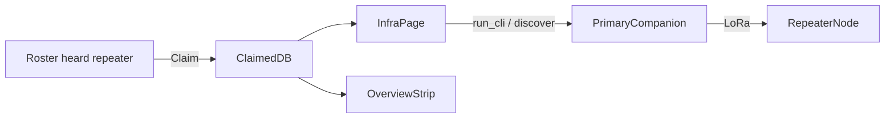

# Infrastructure (claimed repeaters / rooms)

## Product model

Heard nodes stay on Roster/Map. **Claimed** nodes are HQ-owned infrastructure, mirrored after Tracker:

- Operator explicitly claims from roster (or by pubkey)
- Traffic to them goes **through the primary companion** on LoRa (`RadioHandle::run_cli` / existing remote `TXT_TYPE_CLI_COMMAND`)
- Never treat a repeater firmware image as a companion pool radio



## 1. Data: `claimed_infra`

Mirror [`tracked_nodes`](src/db.rs) in [`src/db.rs`](src/db.rs):

```sql
CREATE TABLE IF NOT EXISTS claimed_infra (
  pubkey TEXT PRIMARY KEY,
  kind TEXT NOT NULL DEFAULT 'repeater',  -- repeater | room | sensor
  label TEXT NOT NULL DEFAULT '',
  notes TEXT NOT NULL DEFAULT '',
  added_at INTEGER NOT NULL
);
```

- Migration via existing `ALTER`/`CREATE IF NOT EXISTS` paths
- APIs: `list_claimed_infra`, `claim_infra`, `unclaim_infra`, `update_claimed_notes`, `claimed_pubkey_set`, `count_claimed_infra`
- On claim: default `kind` from `nodes.contact_type` (2→repeater, 3→room, 4→sensor); allow override
- **Do not store admin passwords** in SQLite. CLI login is typed per session (same as MeshCore app); notes may say “admin enabled” only

## 2. Nav + Infrastructure page

- Add `Page::Infrastructure` in [`src/ui/mod.rs`](src/ui/mod.rs); nav item near Tracker (icon: `Radio` or `Signal`)
- New [`src/ui/infra_page.rs`](src/ui/infra_page.rs) (pattern from [`tracker_page.rs`](src/ui/tracker_page.rs)):

**List**
- Claimed cards: label, kind badge, last_heard / GPS from `nodes`, stale styling
- Add: fuzzy pick from roster filtered to types 2/3/4 (or any node with override), plus unclaim

**Detail (selected claim)**
- Identity + map jump (`Page::Map` with pubkey focus if easy; else copy prefix / open Map)
- **Status probe** (rate-limited, e.g. ≥60s per pubkey): queue a small set via `state().radio.run_cli(pubkey, …)` — start with `ver`, `get radio`, `neighbors` (from existing [`INFRA_COMMON`](src/ui/cli_page.rs) presets). Require primary companion linked; show clear error otherwise
- **Remote CLI panel**: draft + Send → `run_cli`; preset chips reused from `cli_page` repeater/room/sensor lists; transcript from `radio.cli_line` / `cli_seq` (same as CLI page). Destructive commands keep the existing confirm pattern from `cli_page`
- Optional: button to run companion-side **Discover repeaters** (`DiscoverNodes`) when linked

## 3. Overview: gated strip only

In [`DashboardPage`](src/ui/mod.rs):

- If `count_claimed_infra() == 0` → **render nothing** for infrastructure
- If claims exist → thin strip (like ops chips): claimed count, how many heard recently (e.g. last_heard within N minutes), link to Infrastructure
- Optional mini sparkline later; v1 is counts + stale/online, not heavy charts
- No widgets for unclaimed heard repeaters

## 4. Roster / Map hooks (light)

- Roster: “Claim” on repeater/room/sensor rows when not claimed; “Claimed” badge when on the list
- Map: claimed infra can reuse Tracker-style emphasis later; v1 minimum is list + Overview — map pin styling only if cheap (optional `claimed` flag in map payload)

## 5. Docs

- [`todo.md`](todo.md): new **Phase I — Infrastructure** with claim store, page, Overview gate, remote CLI/probes
- Product note: companion remains the radio; claimed nodes are mesh targets

## 6. Verify

- DB unit tests: claim/unclaim; kind default from contact_type
- `cargo check` / targeted tests; no warnings
- Manual: claim P1 repeater after discover → Overview strip appears → probe/CLI via linked companion

## Out of scope

- Direct USB text-CLI to repeater firmware (separate from companion protocol)
- Auto-claim every discovered repeater
- Persisting repeater admin passwords
- Making Overview always show repeater chrome when empty
