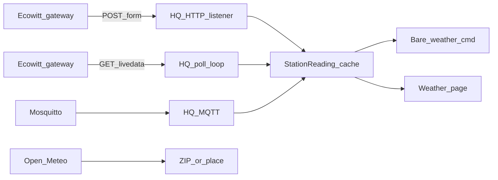

# D1d — Local Ecowitt stations + Weather page

## Goal

Affordable **local** weather stations work without Home Assistant or Mosquitto. v1 supports the **Ecowitt / Fine Offset custom protocol** family (GW1200, WittBoy/GW2001, GW300x, and compatible hubs) via:

1. **Push** — gateway Customized upload → HQ HTTP listener  
2. **Pull** — HQ polls `http://{gateway}/get_livedata_info`  
3. **MQTT** — keep existing bridge path for operators who already have it  

No Ambient / cloud REST. Mesh bare `#weather` and a new **Weather** nav page share one station reading.

## Station model (unify D1c)

Refactor [src/services/mqtt_weather.rs](src/services/mqtt_weather.rs) into a shared station layer (keep MQTT file or split `station.rs`):

- `StationReading`: typed fields (outdoor temp F/C, humidity, wind, gust, direction, pressure, rain day/rate, UV, solar, indoor temp/humidity, `received_at`, `source`: `ecowitt_push` | `ecowitt_pull` | `mqtt`)
- Mesh line still from `try_station_wx_line` (template or compact default)
- Weather page reads full `StationReading` + stale/status helpers
- Freshness: shared `svc_weather_station_stale_secs` (default 3600); migrate/reuse MQTT stale setting or alias both keys

**Priority when multiple sources enabled:** most recent fresh reading wins (any source). Do not invent multi-station aliases yet.

## 1. Ecowitt push listener

- Tokio task on `metis-services` runtime (same as MQTT in [src/services/poller.rs](src/services/poller.rs))
- Bind `0.0.0.0:{port}` default **4199** (Settings-configurable); path default `/data/report` (Ecowitt app often strips leading `/`)
- Accept `POST`/`GET` with `application/x-www-form-urlencoded` (Ecowitt body)
- Parse known keys: `tempf`, `humidity`, `windspeedmph`, `windgustmph`, `winddir`, `baromrelin`/`baromabsin`, rain fields, `solarradiation`, `uv`, `tempinf`, `humidityin`, `stationtype`, `model`, `dateutc`
- Respond `200` quickly; ignore unknown keys
- Optional `PASSKEY` check against setting (empty = accept any)
- **HTTP only** (Ecowitt does not speak HTTPS to custom servers)
- Settings: `svc_weather_ecowitt_push_enabled`, `bind_port`, `path`, `passkey` (0600 file or settings — prefer settings for passkey like a shared secret, or `data/ecowitt.pass` if sensitive)

## 2. Ecowitt pull poller

- When enabled + gateway host set: every N seconds (default **30**, clamp 5–300) `GET http://{host}/get_livedata_info?` via existing `ureq`/`http_get`
- Map `common_list` item ids to the same `StationReading` (outdoor/indoor temp, humidity, wind, baro, rain, UV, etc.) using Ecowitt HTTP API item codes
- Settings: `svc_weather_ecowitt_pull_enabled`, `host`, `interval_secs`
- Failures: set status error; do not clear last good reading until stale

## 3. Settings UI

Under Services, keep **MQTT** tab; add **Ecowitt** tab (or Station → Ecowitt section):

- Push: enable, listen port, path, passkey, show “point gateway Customized → Ecowitt protocol at this HQ IP”
- Pull: enable, gateway IP/host, interval
- Shared: station label, stale seconds
- Status lines for push last RX / pull last OK / MQTT (existing)

Document supported models: GW1200, GW2000/WittBoy, GW3000/GW3002 and Fine Offset–compatible custom upload. Explicitly: no cloud Ambient.

## 4. Weather page

- New nav page `Weather` (after Map / before Infrastructure — operator glance surface)
- Always in nav; empty state → “Enable Ecowitt or MQTT under Settings → Services”
- When fresh reading: cards for temp/feels, humidity, wind, pressure, rain, UV/solar, indoor, last update + source badge
- Stale banner when past stale_secs; link/hint to Settings
- Unit from existing `svc_weather_unit`
- No Open-Meteo forecast on this page in v1 (station dashboard only)

Files: [src/ui/weather_page.rs](src/ui/weather_page.rs), wire in [src/ui/mod.rs](src/ui/mod.rs) (`Page::Weather`, nav search topics).

## 5. Mesh unchanged behaviorally

- Bare `#weather` / `#weather+` current frame: `try_station_wx_line` from unified cache
- ZIP / place / scheduled ZIPs: Open-Meteo only

## Out of scope

- Ambient / any cloud station API  
- Multiple named stations (`wx patio`)  
- Native WeeWX protocol beyond MQTT/Ecowitt  
- Weather-page forecast from Open-Meteo  

## Verify

- Unit tests: parse Ecowitt form body → `StationReading`; map sample `get_livedata_info` JSON; stale gate; mesh line still ≤160  
- `cargo test` / `cargo check` clean  
- Manual: push form to listener → Weather page + bare `#weather`; pull against gateway IP; MQTT still works; disable all → Open-Meteo fallback  
- Docs: check off **D1d** in [todo.md](todo.md); note in [CHANGELOG.md](CHANGELOG.md)
