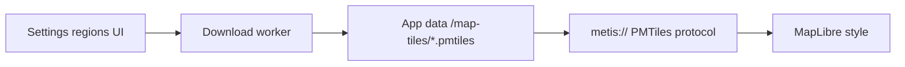

# Map flash fix + multi-region PMTiles downloads

## Root causes of the flash

1. **Hard remount on every basemap switch** in [`src/ui/map_page.rs`](src/ui/map_page.rs): `map_destroy()` → `map_init()` blanks the WebView, then nodes/markers are re-added.
2. **2s poll always calls `map_set_nodes`**, and [`assets/map_bridge.js`](assets/map_bridge.js) `setNodes` → `refreshOverlayMarkers` → `clearLabels()` tears down and recreates every HTML pin (visible flicker even when data is unchanged).
3. **GeoJSON effect depends on `basemap()`**, so a palette switch also retriggers overlay pushes during remount.
4. Dead warning: unused `map_fly_to` in [`src/ui/map_host.rs`](src/ui/map_host.rs) (left after the bottom device list was removed).

## Part A — Stop the flash + warning

- Add `map_set_style(style, preserveCamera)` in the JS bridge that calls MapLibre `map.setStyle(...)`, waits for `style.load`, then re-adds node/route sources (no container destroy). Use this for Outline/Streets/Terrain/Topo switches; keep destroy only on page leave.
- Persist camera across style swaps (already partially done via `preserve_camera` / `map_view`); do **not** set `fitted=false` on basemap change.
- Remove `basemap()` from the GeoJSON refresh dependency tuple so style changes do not double-push data.
- Debounce / fingerprint node GeoJSON: only call `setNodes` when the feature collection hash (or length + sample) changes, or add `MetisMap.setNodes(..., { rebuildMarkers: false })` that `setData`s the source without `clearLabels` when clustering membership is unchanged.
- On the 2s tick: refresh DB model, but skip marker rebuild when fingerprint matches.
- Re-wire `map_fly_to` from pin detail / Fit helpers, or delete it if unused after fingerprint work — eliminate the compiler warning.

## Part B — Multi-region PMTiles download (in HQ)

**Default source:** Protomaps daily vector basemap via `pmtiles extract` (same flow as [Protomaps getting started](https://docs.protomaps.com/guide/getting-started)). Terrain/Topo remain **style variants** of that one vector archive (plus outline fallback); no separate Mapterhorn download in this pass.

### Storage / protocol

- App data dir e.g. `~/.local/share/metis-mesh-hq/map-tiles/`.
- SQLite (or JSON setting) table/list: `id`, `name`, `bbox` (W,S,E,N), `path`, `source_build`, `updated_at`, `bytes`, `status`.
- Extend [`src/pmtiles_path.rs`](src/pmtiles_path.rs) + [`src/main.rs`](src/main.rs) protocol from a single path to **active region id** → file path; URL shape `metis://local/pmtiles/{region_id}` (keep legacy `/basemap` → active).
- Settings keeps a manual path override only as fallback; primary UX is the region list.

### Download worker

- Background task (same radio-thread or a small tokio worker): resolve latest build URL from Protomaps builds index (or pinned `https://build.protomaps.com/{date}.pmtiles`), then run extract:
  - Prefer system `pmtiles` on PATH; else download the official `pmtiles` CLI binary once into app cache and invoke it.
  - `pmtiles extract <remote> <out> --bbox=... --maxzoom=12` (configurable; default 12 for size).
- Progress: status string + percent in Settings (poll DB/settings like radio status).
- Actions per region: Download / Update / Delete / Set active.
- Seed a few named presets (e.g. SoCal, NorCal, PNW, custom “Around HQ” using HQ lat/lon ± ~2°), plus “Add region” with name + bbox fields.

### Vector style so Streets works

- Today [`dark_basemap_style`](src/ui/map_host.rs) assumes **raster** PMTiles; Protomaps builds are **vector** — that is why tiles “do nothing” even with a file.
- Switch active basemap (non-Outline) to a **vector** source + dark Protomaps-compatible layers (roads, water, landcover, boundaries). Vendor a minimal dark style JSON under `assets/` (no CDN glyphs if possible: labels optional/off for v1, or ship a local glyph subset later).
- Outline mode stays bundled land + admin0/admin1 GeoJSON (no download required).

### UI

- Replace/extend Settings → Offline map tiles with a **Regions** card: list, active radio, download/update buttons, last-updated, size.
- Map page banner: if no active region file, keep current Outline CTA; if download in progress, show short status.

## Out of scope (this pass)

- Auto-scheduled silent updates (manual Update button only).
- Separate terrain DEM / topo PMTiles packs.
- Hotlinking the full planet file into the app.
