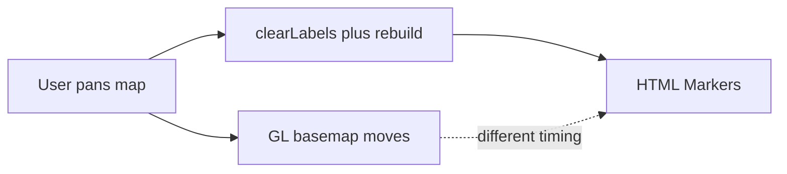

# Map pan and pin performance

## Goals

- **Performance:** Pan/zoom stays on the GL canvas; pins move in the same frame as Streets/Outline (no floating lag).
- **Optimization:** Stop destroying/recreating DOM markers; skip no-op overlay pushes; reduce eval traffic during gestures.
- **Security:** Keep escaped popup HTML, sealed MapLibre DOM events (no Dioxus null-element crashes), and never feed mesh text to shell/HTML outside the existing popup path ([security.mdc](.cursor/rules/security.mdc)).
- **UX:** Preserve type-colored icons, favorite ring, cluster counts, click-to-detail popup, legend, and clustering toggle.

## Root cause (current)

In [assets/map_bridge.js](assets/map_bridge.js), visible pins are `maplibregl.Marker` DOM nodes. Invisible GL circles are hit targets only. `zoomend` / `sourcedata` / `scheduleOverlayRefresh` (idle + 80/250/700/1500 ms) call `refreshOverlayMarkers`, which always `clearLabels` and recreates every pin. Meanwhile [src/ui/map_page.rs](src/ui/map_page.rs) bumps `tick` every 2s and polls eval every 150ms, so the WebView works during drag.

## Approach (locked)

**Pins and clusters become GL layers.** HTML Markers for nodes/clusters go away. The existing MapLibre `Popup` for detail (copy link, QR, favorite) stays HTML with `escapeHtml` / sealed clicks.

**Icons:** At map init / first `ensureNodeLayers`, register sprite images (`hq`, `chat`, `repeater`, `room`, `sensor`, `node`, plus favorite variants) by rasterizing the same SVG paths already in `typeIconSvg` onto small canvases and `map.addImage(...)`. Layers use `icon-image` from `type_key` / favorite props (data already on features from Rust).

**Name labels:** A separate `symbol` layer for names, with collision (`text-optional`, `icon-allow-overlap` false for labels), shown only above a zoom threshold (reuse today’s rough gating: denser when zoomed in). Click still opens the detail popup for full type/name.

**Clusters:** Visible GL `circle` + `symbol` (`text-field: point_count`) with cool/warm/hot colors by count steps. Remove the invisible-only cluster circle + HTML cluster pill path. Keep click-to-expand via `getClusterExpansionZoom`.

**No rebuild-on-zoom for pins:** Delete `refreshOverlayMarkers` / `scheduleOverlayRefresh` / `clearLabels` usage for nodes once GL layers own the UI. `setNodes` only `setData` when fingerprint changes (already partially there).

**Gesture-aware Rust refresh:**

- JS sets `window.__metisMapMoving = true` on `movestart`/`zoomstart`, false on `moveend`/`zoomend` (and publish camera only on end, as today).
- Replace the 2s unconditional `tick` loop with a **5s idle refresh** that skips when `__metisMapMoving` is true (cheap global read via existing `eval_value`/`eval_string`). Filter / favorites / cluster / style still bump `tick` immediately.
- Slim the 150ms loop: read selection/favorite/camera from window globals written by JS; only call heavier bridge APIs when a seq/flag changes. Region-draft snapshot only while `draft_placed` and seq changed.

## Primary files

- [assets/map_bridge.js](assets/map_bridge.js) — icon registration, visible GL layers, remove HTML node/cluster markers, moving flag, lighter overlay refresh API.
- [assets/form.css](assets/form.css) — keep legend swatches; drop unused `.metis-node-marker` / cluster-marker rules if dead; popup styles stay.
- [src/ui/map_page.rs](src/ui/map_page.rs) — idle tick + skip-while-moving; cheaper poll.
- [src/ui/map_host.rs](src/ui/map_host.rs) — only if new eval helpers are needed for the moving flag / seq reads (keep `return`-prefixed `eval_value`).

## Security / UX checklist

- Popup content continues through `escapeHtml` / `detailHtml`; no new raw mesh strings into HTML.
- MapLibre layer clicks stay on the map canvas (no new unsealed DOM markers for pins).
- Favorite toggle and copy-link behavior remain in the detail popup.
- Legend and type colors stay aligned with layer paint / icons.
- Offline pack draft square stays GeoJSON (unchanged); do not reintroduce drag-time `publishLiveDraft` every frame.

## Verification

- Pan/zoom: pins stay glued to geography (no second of float).
- Cluster on/off and zoom-to-expand still work.
- Click pin → detail popup; favorite/copy still work.
- Leave Map page and return: map still remounts correctly (`isLive` / `destroyIfDetached`).
- `cargo check` / `cargo test` clean (treat warnings as errors per [quality.mdc](.cursor/rules/quality.mdc)).
- Manual: drag map with many nodes + Streets pack; confirm no eval storms (optional: watch that tick does not fire mid-pan).
