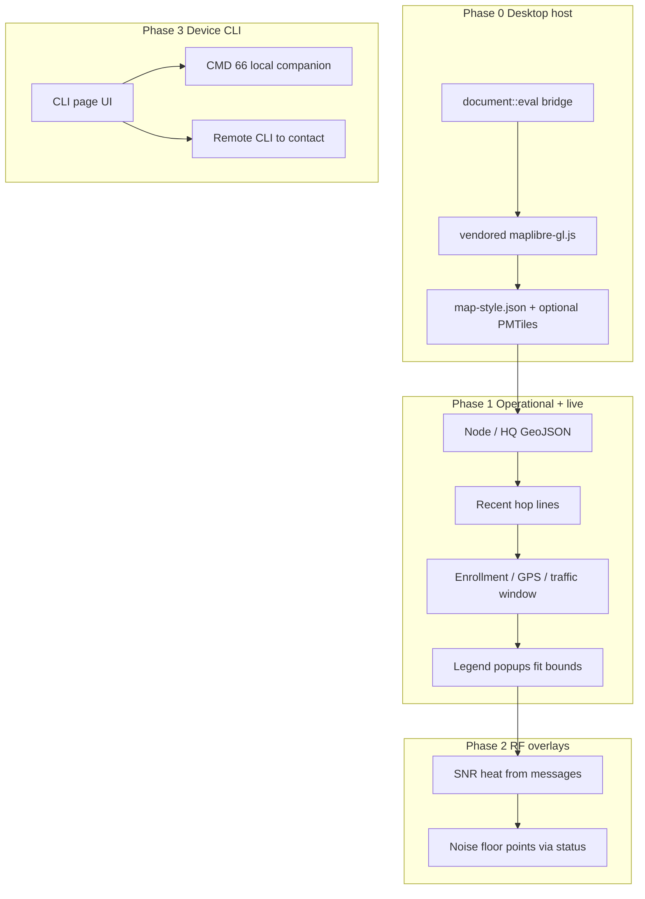

# Map section + Device CLI

Map: desktop host, operational mesh, RF overlays. Also: in-app MeshCore CLI page (previously deferred).

## Reality check

[`src/ui/map_page.rs`](src/ui/map_page.rs) already draws GeoJSON nodes + solid/dashed hop lines over a dark empty style, and Settings stores `pmtiles_path` — but **`dioxus-maplibre` 0.0.9 only initializes MapLibre under `cfg(target_arch = "wasm32")`**. On desktop (`dx serve --platform desktop`), `MapHandle` / `document::eval` paths in that crate are no-ops, so the page is effectively an empty container. PMTiles and fit-bounds cannot ship until we own a desktop JS bridge.

RF “tools” in MeshCore apps are not a full RF planner. What we can ground in protocol + DB today:

- **SNR** on RX messages (already a column in SQLite; companion v3 frames carry it)
- **Noise floor / last RSSI** via `request_status` → [`StatusData`](https://docs.rs/meshcore-rs) (`noise_floor`, `last_rssi`, `snr`)
- **Resolved hop paths** via existing [`src/path.rs`](src/path.rs) / `paths` table
- Trace-path opcode exists in firmware; meshcore-rs does not wrap it yet — defer live TRACE UI unless raw send proves easy mid-pass

## Phase 0 — Desktop MapLibre host (blocker)

Build a thin HQ-owned bridge in something like [`src/ui/map_host.rs`](src/ui/map_host.rs) (keep using vendored [`assets/maplibre-gl.js`](assets/maplibre-gl.js) / CSS; no CDN):

1. On Map mount: `document::eval` to `new maplibregl.Map({ container, style, center, zoom })`.
2. Expose helpers: `setGeoJson(sourceId, FeatureCollection)`, `setLayerVisibility`, `fitBounds`, `flyTo`, destroy on unmount.
3. Keep declarative Rust model in [`map_page.rs`](src/ui/map_page.rs) (build GeoJSON in Rust → push over the bridge). Drop reliance on dioxus-maplibre’s wasm-only `Map` init for desktop; may still reuse types if convenient, or remove the dep later if unused.
4. Center/zoom: compute bounds from HQ + GPS nodes (padding); fallback world view when empty.

## Phase 1 — Operational basemap + live mesh

### Offline PMTiles

1. Vendor `pmtiles` JS next to MapLibre; register `maplibregl.addProtocol('pmtiles', …)` once at host init.
2. Serve the local file from Settings `pmtiles_path` via a **desktop custom protocol** (e.g. `metis://pmtiles/...` reading the path from DB) so the WebView never needs `file://` or a CDN.
3. When path is set and file exists, rebuild style: raster or vector source `url: "pmtiles://metis://pmtiles/basemap"` plus minimal dark land/road layers (or raster tiles if the user’s archive is raster). When unset/missing, keep today’s solid dark background and show a clear banner: “Add a regional PMTiles path in Settings.”
4. Settings copy: change “can be selected later” to working instructions (expected Protomaps/OSM PMTiles; offline-only).

### Mesh layers and chrome

In [`map_page.rs`](src/ui/map_page.rs) + light CSS in [`assets/form.css`](assets/form.css):

- **HQ marker** distinct from peers (star / larger circle + `enrollment=hq`).
- **Data-driven node colors**: enrolled / pending / heard / hq (props already include `enrollment`).
- **Filters** (toolbar): All | Enrolled | Heard | Has GPS; toggles for solid routes / dashed routes.
- **Traffic window**: recent N messages (default 25) or last 1h / 6h / 24h — filter `recent_messages` in [`db.rs`](src/db.rs).
- **Legend** overlay (HQ, enrolled, heard, solid = resolved hops, dashed = endpoints only).
- **Click popup** (side panel or MapLibre popup via eval): name, enrollment, last heard, lat/lon, open Roster/Inbox deep-link later if cheap.
- **Fit to nodes** button + auto-fit once when data first appears.
- Sync HQ coords to DB when Settings/`set_coords` succeeds (today status updates can lag `nodes` used by the map).
- Lightweight refresh while Map is open (poll DB every ~2–3s or on radio status tick) so new adverts/paths appear without leaving the page.

Hop lines stay on [`build_line`](src/path.rs); improve feature props (`outbound`, hops) for popup text only — no RF math here.

## Phase 2 — RF overlays (practical, not LoS planner)

Ship as Map toolbar layers, not a separate Tools nav yet:

1. **SNR heat / circles** — from messages that have `snr` + a placeable sender (or HQ for TX). Aggregate recent window into GeoJSON points with `circle-color` / `circle-opacity` by SNR bands. Persist is already there; ensure radio ingest fills `snr` on v3 RX if not already.
2. **Noise floor points** — operator action “Probe noise” (or auto for visible contacts with GPS): `commands.request_status(dest)` → store `(pubkey, noise_floor, last_rssi, at)` in a small SQLite table → map circles. Show last probe time in the panel.
3. **Coverage sketch** — optional second pass: simple hex/grid or weighted circles from (position, snr/noise) samples — visual only, labeled as approximate.
4. Explicitly **out of this plan**: terrain LoS, full MeshCore “Rx log / discover” tools nav, live TRACE UI (add later if raw `CMD_SEND_TRACE_PATH` is wired).

## Phase 3 — Device CLI page

Church/emergency operators often need serial-style MeshCore commands without a phone. Add a dedicated **CLI** nav page (not buried only under Settings Advanced).

### Protocol

- **Local companion** (primary): firmware v14+ `CMD_RUN_CLI_COMMAND` (66) → `RESP_CODE_CLI_REPLY` (29). Frame: `[66][utf8 command…]`. meshcore-rs does not wrap this yet — send via existing `commands.send` like radio params. Require connected companion; surface a clear error if the board rejects / times out (older FW).
- **Remote node** (secondary): send `TXT_TYPE_CLI_COMMAND` to a selected contact (repeater / room / sensor) using the companion’s existing text-send path with the CLI type. Target picker from roster contacts that look like infrastructure (type repeater/room/sensor when known).
- Docs reference: [CLI Commands](https://docs.meshcore.io/cli_commands/) (repeaters/rooms/sensors; companion also runs a subset via `handleCommand`).

### UI

- New page in nav (e.g. **CLI** next to Settings / after Map): terminal-style transcript (scrollback), single-line input, Send / Enter, Clear.
- Target selector: **This companion** | **Contact…** (dropdown of saved contacts).
- Session transcript kept in memory for the window; optional persist last N lines in SQLite later (not required for v1).
- Quick chips for safe read-only commands (`clock`, `neighbors`, `get …` help if known) — not a full command encyclopedia in-app; link/note to MeshCore docs.
- **Guards**: confirm dialog before destructive commands matching `erase`, `reboot`, `poweroff`, `shutdown`, `factory` (case-insensitive prefix). Serial-only `erase` still may fail over BLE — show reply text.
- Disabled / CTA to pair when not connected.

### Radio wiring

- [`src/radio.rs`](src/radio.rs): `RadioCmd::RunCli { target: Local | ContactPrefix([u8;6]), text }`; await CLI reply event or timeout; push reply into `RadioStatus` or a small CLI transcript channel the UI polls.
- Parse/register `EventType` for CLI reply if meshcore-rs exposes it; otherwise match response code 29 on raw event path / extend handling as needed.

## Files

- New: [`src/ui/map_host.rs`](src/ui/map_host.rs) — desktop eval bridge + PMTiles protocol bootstrap
- Edit: [`src/ui/map_page.rs`](src/ui/map_page.rs) — layers, filters, legend, popups, RF overlays
- New: [`src/ui/cli_page.rs`](src/ui/cli_page.rs) — Device CLI terminal UI
- Edit: [`assets/map-style.json`](assets/map-style.json) — optional basemap layer stubs; dynamic style may be built in Rust
- Add: `assets/pmtiles.js` (vendored)
- Edit: [`src/main.rs`](src/main.rs) / desktop config — custom protocol for local PMTiles bytes
- Edit: [`src/db.rs`](src/db.rs) — time-windowed messages; optional `rf_samples` / status probe table; ensure HQ position write path
- Edit: [`src/radio.rs`](src/radio.rs) — status probe cmd; SNR on insert if missing; `set_coords` → DB HQ row; `RunCli` + reply
- Edit: Settings PMTiles blurb + nav page mount in [`src/ui/mod.rs`](src/ui/mod.rs)

## Acceptance

- Opening Map on desktop shows a live MapLibre canvas (not an empty div).
- With `pmtiles_path` pointing at a valid local archive, roads/land appear offline; without it, dark basemap + clear CTA.
- HQ and peers are distinguishable; filters change visible nodes/routes; fit-bounds frames GPS set.
- Clicking a node shows identity + coords.
- RF layer: recent SNR samples visible; noise probe writes a point for at least one contact with GPS.
- CLI page: connected companion accepts a local command (e.g. `clock`) and shows the reply; destructive commands require confirm; remote target can send a CLI command to a selected contact when firmware allows.

## Out of scope

QR share/print, Device Settings work already done, CDN tiles, full RF planning / LoS, full Tools nav (Rx log / discover) beyond Map RF layers + CLI page.