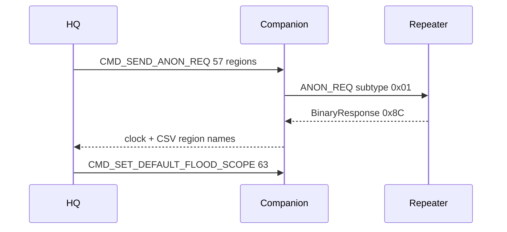

# MeshCore region scan and select

## Goal

Replace the free-text-only flood scope field under **Settings → Device → Network** with:

- **Scan regions** from nearby repeaters/rooms
- **Dropdown** of known regions (scanned + manually added)
- **Manual add** when a code is known but not heard
- **Apply / Clear** to set or clear the companion default scope

Defer per-channel scopes; this pass is default scope only.

## Protocol facts (locked)

- **Discover:** `[57][pubkey:32][0x01][0x00]` per MeshMonitor / MeshCore anon regions request; reply is `PUSH_CODE_BINARY_RESPONSE (0x8C)` = `u32 LE clock` + NUL-terminated comma-separated ASCII names. Drop `*`. Query **sequentially** (tag matching is fragile if overlapped).
- **Targets:** HQ roster nodes with `contact_type` 2 (Repeater) or 3 (Room) that have a full pubkey.
- **Region name rules:** lowercase `a-z0-9-`, max 29 bytes; normalize input to lowercase; reject invalid.
- **Scope key:** first 16 bytes of `SHA256("#" + name)` (name without leading `#` in UI; hash always uses `#name`).
- **Apply default:** prefer `CMD_SET_DEFAULT_FLOOD_SCOPE (63)` = `[63][name 31 NUL-padded][key 16]`, or `[63]` to clear. Also clear session override via existing CMD 54 clear path when clearing.
- **Bug fix:** current [`meshcore-rs` `set_flood_scope`](https://docs.rs) / HQ `SetFloodScope` pads the **name string** into 16 bytes. That is wrong for CMD 54 (expects a key). Stop using that helper for Apply; send raw 63/54 frames from HQ like path-hash already does in [`src/radio.rs`](src/radio.rs).

## Implementation

### 1. Region helpers — new `src/mesh_regions.rs`

- `normalize_region_name`, `validate_region_name`
- `region_scope_key(name) -> [u8; 16]`
- `parse_regions_binary_response(data: &[u8]) -> Vec<String>` (skip clock, split CSV, drop `*` / empties, validate)
- Unit tests for key stability and response parsing

### 2. Persist known list — settings in [`src/db.rs`](src/db.rs) / Settings UI

- `mesh_regions` = JSON array of strings (known codes)
- `mesh_region_active` = selected name or empty for unscoped
- Helpers: load/save/merge/dedupe; audit `regions_scan` / `region_apply`

### 3. Radio task — [`src/radio.rs`](src/radio.rs)

- Add `RadioCmd::DiscoverRegions { reply: oneshot }` and `RadioCmd::SetDefaultFloodScope(Option<String>)`
- **Discover:** from connected companion, load repeater/room pubkeys from DB (pass list in the cmd, or query DB inside the task the same way other cmds do). For each pubkey, send raw `[57][32][1][0]`, wait for `MsgSent` then matching `BinaryResponse`, parse names, merge unique. Soft-timeout per target (~3–5s); skip failures. Cap targets (e.g. first 12) so scan stays usable.
- **Apply:** build CMD 63 frame with name+key; on `None`, send `[63]` clear. Update `RadioStatus.flood_scope` with the human name (not the key). Surface errors via existing toast/CLI note path.
- Keep path-hash UI as-is in the same Network card.

### 4. Network UI — [`src/ui/mod.rs`](src/ui/mod.rs) Device → Network

Replace the single text field with:

1. Select: `(none / unscoped)` + known regions  
2. Manual add: text + **Add** (validate, merge into `mesh_regions`, select it)  
3. **Scan regions** (disabled when radio disconnected / scan running; status text for progress / last count)  
4. **Apply scope** / **Clear** (writes radio + `mesh_region_active`)  
5. Short help: names must match local repeater config exactly; scan queries nearby repeaters/rooms

### 5. Wire-up / polish

- Export module from [`src/main.rs`](src/main.rs)
- Toast on scan complete / apply failure
- `cargo test` for region helpers; `cargo check` clean (warnings as errors)

## Out of scope

- Per-channel scope override before each TX  
- Editing repeater `region put` trees from HQ  
- Bundling community catalogs (meshcore-regions JSON) — manual + scan only for now
