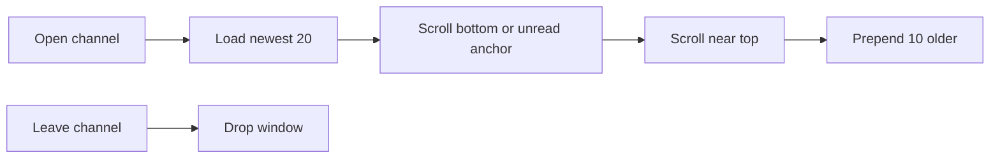

# Messages window, mentions, block, roster clear

## Scope

1. Channel/DM message window (initial 20, load 10 older on scroll-up, reset on leave)
2. HQ @mention detection → badge tone + Overview KPI
3. Block confirm verbiage (Cancel / Confirm Danger) already present — keep that pattern; improve resolve failure copy
4. Roster: **Clear NEW** + **Remove heard-only** (clean slate for heard nodes), each with Cancel/Confirm warning dialogs

## 1. Message window (perf)

**Root cause:** [`MessagesPage`](src/ui/mod.rs) loads `list_channel_messages(slot, 400)` / `list_dm_messages(..., 400)` and renders every bubble. Queries also use `ORDER BY ASC LIMIT N` (oldest N when history is large).

**DB** ([`src/db.rs`](src/db.rs)):
- Change `list_channel_messages` / `list_dm_messages` to return the **newest** `limit` rows, still ordered oldest→newest for the pane (subquery `ORDER BY DESC LIMIT` then outer `ASC`).
- Add `list_channel_messages_before(slot, before_id, limit)` and `list_dm_messages_before(pubkey, before_id, limit)` for older pages (`id < before_id`, same join shape, newest-of-older then ASC).
- Keep path join for now (hop UI uses it); window size is the main win.

**UI** ([`src/ui/mod.rs`](src/ui/mod.rs)):
- Signals: `loaded_messages`, `has_older`, `loading_older` (or equivalent).
- On channel/DM select: load newest **20**; scroll to bottom / unread anchor as today.
- On `#channel-scroller` (and DM scroller) near top: if `has_older` and not loading, prepend **10** older; preserve scroll position after prepend.
- Leaving the thread / switching channel: drop the window; next open starts at latest 20 again.
- Unread banner / `channel_last_read` logic stays; it only needs IDs in the loaded window or DB last-read, not full history.

## 2. Mentions of the companion

**Identity:** match MeshCore `@[name]` / `@name` against [`hq_advert_name()`](src/db.rs) (settings `hq_name`, else HQ-enrolled node name), case-insensitive.

**Ingest** ([`src/radio.rs`](src/radio.rs) channel RX path ~4424):
- After parsing body, set `mentions_hq` when text mentions HQ name (reuse mention parse rules from [`split_mentions`](src/ui/mod.rs); shared helper in a small fn used by radio + UI).
- Persist on insert: add `messages.mentions_hq INTEGER NOT NULL DEFAULT 0` (+ migrate ALTER).

**Unread / badges:**
- Extend channel/DM unread aggregation (or parallel counters) with `unread_mentions` = rx rows newer than last-read with `mentions_hq = 1`.
- Rail + Messages nav badge: keep numeric unread; if any unread mention, use a distinct CSS class (e.g. `.channel-unread-badge-mention`) so the pill reads differently from plain unread.

**Overview (updated):** Mentions lives on the Overview **messages chip row** (with Unread / Channels / Direct), not as a fifth `OverviewStat`. See [overview_kpi_strip_a785827d.plan.md](overview_kpi_strip_a785827d.plan.md).

## 3. Block contact feedback

Already wired: [`BlockContactDialog`](src/ui/mod.rs) with Cancel + Danger Confirm for channel + DM.

**Shipped:** Channel Block matches MeshCore mobile — when no roster pubkey is available, block by **display name** (`name:<alnum>` in `blocked_nodes`). Channel RX drops matching names; hearing the node later promotes the real pubkey (so DMs drop too). Fail dialog only when the frame has **no** sender name.

Keep Cancel/Confirm. Channel vs DM share one dialog body (name-only copy notes channel-first filtering).

## 4. Roster clear controls (option 3)

On Roster page header ([`RosterPage`](src/ui/mod.rs)), two actions:

| Action | Effect | Dialog |
|---|---|---|
| **Clear NEW** | `UPDATE nodes SET noticed = 1 WHERE noticed = 0` (exclude nothing needed; HQ already noticed) | Warning: clears NEW badges only; Cancel / Confirm |
| **Remove heard-only** | Delete nodes with `enrollment = 'heard'` only; keep enrolled, pending, denied, HQ | Strong warning with count; Cancel / Confirm Danger |

**Remove heard-only cleanup** (same transaction):
- Delete matching `nodes` rows.
- Also remove those pubkeys from `tracked_nodes`, `blocked_nodes`, and `claimed_infra` so leftovers do not orphan UI.
- Leave messages/paths (sender_pubkey may go NULL-ish via join); do not cascade-delete message history in this control (Settings purge remains the history tool).
- Write an `audit` row (`roster_clear_new` / `roster_prune_heard`).

Product note: Settings purge already keeps roster; this is the intentional roster clean-slate for **heard** noise, not enrolled members.

## Files to touch

- [`src/db.rs`](src/db.rs) — newest-N queries, before-id pages, `mentions_hq` column + counters, `mark_all_noticed`, `prune_heard_nodes`
- [`src/radio.rs`](src/radio.rs) — set `mentions_hq` on channel (and DM if body can mention) insert
- [`src/ui/mod.rs`](src/ui/mod.rs) — message window state, mention badge class, Overview KPI, resolve-fail dialog, Roster clear dialogs
- [`assets/form.css`](assets/form.css) — `.channel-unread-badge-mention`

## Tests

- DB: newest-N returns latest; before-id page prepends older; `mentions_hq` insert/count; prune heard keeps enrolled/HQ and clears tracked/blocked/claimed for removed keys; mark_all_noticed zeros unnoticed count.
- `cargo test` + `cargo check` clean (no warnings).
