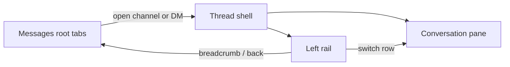

# Messages conversation sidebar

## Scope

Keep the **root** Messages view as it is today (Channels / Direct tabs, create channel, Send direct message, retention cards). When a channel or DM thread is open, replace the full-bleed single-column thread with a **two-pane shell**: left rail + conversation.

## Layout

In [`src/ui/mod.rs`](src/ui/mod.rs) (`MessagesPage`), both early-return branches (`selected_dm` and `selected_channel`) share one shell:

- Outer: `messages-shell` (flex row, `hq-page-fill`, drop `max-w-4xl` so the rail has room).
- Left: sticky/scrollable `messages-rail` (~15rem), two labeled groups: **Channels** then **Direct messages** (never mixed).
- Right: existing thread header + message list + composer (breadcrumb still returns to root).

Narrow viewports (`form.css` media query): rail stacks above the conversation as a horizontal scroll chip strip so the composer stays usable (same pattern spirit as Help TOC collapsing).

## Rail rows

Each row shows:

- **Avatar** — new `ConversationAvatar` in [`src/ui/widgets.rs`](src/ui/widgets.rs): circle, first letter of the display name (A–Z / 0–9; fallback `#`), background from a fixed ~8-color palette picked by a stable hash of channel name or DM pubkey (not random per render).
- **Label** — channel `name`; DM device/node name (`DmThreadRow.name` / roster title).
- **Unread badge** — reuse existing `channel-unread-badge` + `unread_count` (channels already exclude TX; DMs already tracked).
- **Active state** — CSS class when `selected_channel` / `selected_dm` matches.
- **Click** — set the matching selection, clear the other, reset draft/reply/read session as today’s open handlers do.

## Row actions (delete / clear)

Defaults (no separate “leave mesh channel” — HQ does not implement MeshCore leave):

| Kind | Action label | Behavior |
|------|--------------|----------|
| Operator channel | Delete | Existing [`soft_delete_channel`](src/db.rs); same guards as root cards (block Public + reserved private). If the open channel is deleted, clear selection and return to root. |
| System channel | — | No delete control. |
| DM thread | Clear | New `Db::clear_dm_thread(pubkey)`: delete that peer’s DM messages, clear `dm_last_read_*` setting; thread drops out of `list_dm_threads`. Does **not** revoke enrollment. If that DM is open, clear selection. |

Confirm destructive actions with the existing `Dialog` pattern (same spirit as Settings purge). Actions sit on the row as a compact icon/button (visible on hover or always on touch-friendly density via CSS).

## Implementation pieces

1. **CSS** in [`assets/form.css`](assets/form.css): `.messages-shell`, `.messages-rail`, `.messages-rail-section`, `.messages-rail-item` (+ active), `.messages-avatar` (+ palette utility classes or inline `style` from the hash index).
2. **`ConversationAvatar { label, seed }`** widget — `seed` = channel name or pubkey for color stability.
3. **`MessagesRail`** (private component next to `MessagesPage` in `mod.rs`) — props: channels, dm_threads, selected channel/dm, callbacks for select / delete channel / clear DM.
4. **DB** — `clear_dm_thread` + a small unit test beside existing DM unread tests in [`src/db.rs`](src/db.rs).
5. Wire both thread views through the shell; keep root tabs untouched aside from any shared avatar reuse on cards (out of scope unless trivial—prefer rail-only first).

## Out of scope

- Changing root tab UX or removing breadcrumbs.
- True MeshCore “leave channel” / radio contact removal.
- Hiding DMs without deleting history (would need a new hide table).
