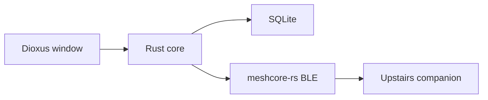

# Metis Mesh HQ

The workspace at `/home/drose/Projects/MetisMesh HQ` is empty. This pass builds the local headquarters only: a standalone Rust desktop app for Linux now, with Windows and macOS as the same binary later. The cloud portal, weather and alert bots, incident roll call, and HQ-to-HQ bridge stay in the rules as later phases so they are not forgotten and are not half-built.

## Cursor rules

Add always-on rules in [`.cursor/rules/`](.cursor/rules/) so later sessions keep the decisions from this design. One concern per file, each short.

- `product.mdc` — Emergency communications for communities. Offline-first. Whitelist. Private channels. Isolated until two HQs choose to link. Community relay, not an official warning system.
- `stack.mdc` — Rust, Dioxus 0.7 desktop, Rust/UI plus Tailwind, `dioxus-maplibre`, `meshcore-rs` with BLE, SQLite. No Docker. Native window on this laptop and the LattePanda.
- `radio.mdc` — Companion protocol. Incremental contact sync. Save every parsed field and the raw frame. GPS only when an advert or telemetry includes it. Public key is identity. Hop count always. Route from advert path, outbound path, or an operator trace. One connection per radio. Multiple radios in one database. Contact table on the radio is finite.
- `security.mdc` — Operator approval before a channel secret is sent. Resolve the 6-byte prefix to exactly one 32-byte key. Mesh text is plain text, never a shell or HTML. Rate-limit replies. Secrets out of the message view and out of git. Revoking one node means rotating the channel secret.
- `bridge.mdc` — Later phase. Link HQs, do not merge meshes or share community secrets. Aid bulletins only. Radio path and IP path. Either side can unlink.

## App skeleton

Hand-write the Dioxus 0.7 project at the repo root (the `dx new` prompts are interactive). Desktop is the default feature. `tailwind.css` at the root so `dx` runs Tailwind. Copy in a small Rust/UI set: button, card, table, dialog, input, badge. Dark theme.

Layout:

- `src/main.rs` launches the desktop window
- `src/radio/` BLE session and ingest
- `src/db/` SQLite
- `src/signup/` command parse and approval
- `src/ui/` map, roster, inbox, messages, settings
- `data/` gitignored database and local radio config

Dependencies: `dioxus` 0.7, `meshcore-rs` 0.2 with `ble`, `rusqlite` with bundled SQLCipher-free SQLite (WAL), `tokio`, `serde`, `dioxus-maplibre`, `keyring` for the channel secret. If the desktop keyring is unavailable, fall back to a `0600` file under `data/` and say so in the UI.

## Data

SQLite WAL, indexes on message time and sender key. Tables:

- `radios` — transport, address, label, last error
- `nodes` — full contact fields, enrollment state, self-reported position separate from an enrolled site pin, raw advert fields
- `messages` — direct and channel, hop count, SNR, signature, delivery state, raw frame, dedupe key
- `paths` — hash list, source (`advert`, `out_path`, `trace`), timestamp
- `channels` — name and secret id (secret itself in the keyring)
- `settings` — retention default forever, purge window, HQ display name
- `audit` — approve, deny, transmit

Retention setting is stored and a confirmed purge deletes messages, paths, and location trails older than the window. Roster, secrets, and the audit log stay.

## Radio

One Tokio task owns the upstairs radio. Connect with `MeshCore::ble_connect` after the radio is paired and trusted in BlueZ. The phone app cannot hold that Bluetooth link at the same time. On connect: `send_appstart`, `device_query`, set the clock, `get_contacts(since)`, drain queued messages, subscribe to contact and channel messages, and turn on auto message fetch.

Persist incremental updates. After a direct message from a known contact, request the cached advert path when `meshcore-rs` exposes it. If that command is not wrapped, send the documented `CMD_GET_ADVERT_PATH` (`0x2A`) frame from our code. Match hop hashes to known keys in memory. A prefix that matches two nodes is marked ambiguous.

The radio list is a pool. This pass connects one Bluetooth radio. USB uses the same pool later.

## Signup and roster

Direct messages `signup`, `signup <name>`, and `status` drive a small state machine. Unknown keys get the signup line only. Approval is a button on the inbox. Approve generates a private-channel secret, stores it in the keyring, and sends one direct message telling them the channel name and secret. The transcript shows `secret sent` instead of the secret. Deny records an audit row. The roster shows enrolled, pending, and heard nodes, with last heard and whether a GPS fix exists.

## Map

A MapLibre view via `dioxus-maplibre`. Vendor the MapLibre JS and CSS in `assets/` so the map does not load from a CDN. The first basemap is a local dark style with no network tiles, plus a setting for a PMTiles file later. Enrolled and heard nodes with coordinates are markers. A message with a resolved path is a solid line. A message with only a hop count is a dashed line between the two ends we can place. Lines on screen are the recent set. History stays in SQLite.

## Checks

Unit tests for the signup parser, hop-hash matching, and message dedupe. Run the desktop app with `dx serve --platform desktop`. Bluetooth success depends on the upstairs radio being paired and the phone app disconnected. If the link does not come up, the window should show the scan error and stay usable.

## Later, not in this pass

`#weather` and other info commands, alert feeds with operator confirm, incident roll call, room-server bulletin replay, cloud enrollment sync, and the HQ bridge protocol. The schema should not block those: nodes already have enrollment state, and messages already have a dedupe key and an origin.