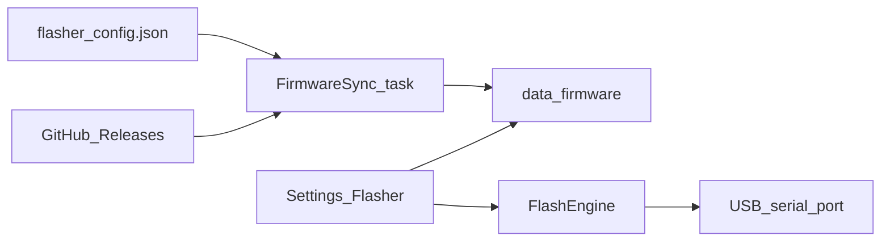

# Offline MeshCore firmware locker + USB flasher

## Locked scope

- **Locker + in-app flash**: download/mirror assets and flash from HQ over USB.
- **Wide mirror**: all MeshCore **community** firmwares for every board/role in the official flasher catalog — not a curated subset. Skip Ripple-only images (separate product).
- **Keep current**: always retain the **latest** release per family (`companion`, `repeater`, `room-server`); also keep the **previous** tagged release for rollback. Prune older tags automatically.
- Expect roughly 0.7–1.5 GB for one full version set (companion alone is ~260 MB); two versions ~1.5–3 GB under `data/firmware/` (gitignored).

## Architecture



### Sources of truth

1. **Device/role catalog**: `https://flasher.meshcore.io/config.json` (MIT flasher repo). Each community entry carries `github.type` (`companion` | `repeater` | `room-server`) and regexes for `flash-wipe` / `flash-update` (and nRF52 zip/uf2 patterns). T-Beam Supreme already maps BLE/USB/repeater/room roles this way.
2. **Binaries**: GitHub Releases on `meshcore-dev/MeshCore` — separate tags per family (`companion-v…`, `repeater-v…`, `room-server-v…`). Resolve latest **per family** (do not use a single `/releases/latest`; that is often only companion).

Reuse the existing download/progress pattern from [`src/map_tiles.rs`](src/map_tiles.rs) (`ureq`, background thread/task, status mutex polled by UI).

### On-disk layout

```text
data/firmware/
  catalog.json              # last fetched flasher config + fetched_at
  index.json                # local inventory: tag, asset, sha256, bytes, path, family
  releases/
    companion-v1.18.0/
      *.bin / *-merged.bin / *.uf2 / *.zip
    repeater-v1.18.0/
    room-server-v1.18.0/
```

Verify size (and digest when the release API provides one); refuse to flash a partial/corrupt file.

## Background sync

- New module [`src/firmware.rs`](src/firmware.rs) (split a `flash` submodule if the file grows).
- Spawn from [`src/main.rs`](src/main.rs) beside radio/services: on startup when online, every **12 hours**, and Settings **Sync now**.
- Pipeline:
  1. Fetch `config.json` and save `catalog.json`.
  2. For each family, list releases via GitHub API; pick latest + previous tags.
  3. Download **all** assets for those tags into `releases/{tag}/` (wide mirror). Skip when `index.json` already has matching size/sha.
  4. Prune tags not in the keep set; update `index.json`.
- Offline: sync no-ops with clear status (`Last synced … · N assets · offline`). Flasher UI works entirely from cache.
- Settings: `firmware_sync_enabled` (default on), `firmware_sync_interval_hours` (default 12).

## Flash engine

| Platform (`device.type`) | Update (default) | Full erase / wipe |
|---|---|---|
| `esp32` | app `.bin` at `0x10000` via **espflash** (Rust) or `esptool` CLI fallback | `-merged.bin` at `0x0` — only when Erase is checked |
| `nrf52` | DFU `.zip` via `adafruit-nrfutil` / `nrfutil` if present; else show path + copy-UF2 instructions | same package; warn about identity wipe |

Locked flash defaults:

- **Erase off** by default (preserve MeshCore identity / pubkey). Strong confirm when Erase is on.
- Before flash: if the chosen USB path is a live radio-pool slot, **disconnect that slot** first.
- Operator picks: device → role → version (from local index) → USB port (reuse [`src/usb_serial.rs`](src/usb_serial.rs)) → Flash.
- Progress + log lines in the Flasher panel.
- MIT attribution in UI: firmware from MeshCore; HQ only mirrors and flashes.

## UI — Settings → Flasher

Add a fourth top-level Settings tab next to HQ / Device / Diagnostics in [`src/ui/mod.rs`](src/ui/mod.rs):

- **Library**: sync status, last success, disk used, Sync now, Open folder.
- **Flash**: device search (cached catalog, community only), role badges (Companion BLE / USB / Repeater / Room / KISS when present), version from **local** files only, port picker + Refresh, Erase checkbox, Flash button.
- Disable Flash when the required asset is missing; offer Sync now instead of hitting the network mid-flash.
- Copy that matches flasher tooltips (BLE companion is not USB companion).

## Files to touch

- [`Cargo.toml`](Cargo.toml) — `espflash` (or document system `esptool`); DFU via external CLI first.
- [`src/firmware.rs`](src/firmware.rs) — catalog, sync, index, flash orchestration, status API.
- [`src/main.rs`](src/main.rs) — spawn background sync.
- [`src/db.rs`](src/db.rs) — settings keys only (no blobs in SQLite).
- [`src/ui/mod.rs`](src/ui/mod.rs) — Flasher tab.
- [`todo.md`](todo.md) — Phase G: locker, background sync, USB flasher.
- Keep binaries under gitignored `data/`.

## Tests / verify

- Unit: parse a fixture slice of `config.json`; match T-Beam Supreme BLE wipe/update regexes to sample asset names.
- Unit: release keep-set prunes older tags; index skips already-present assets.
- Unit: erase-off selects `flash-update`; erase-on selects `flash-wipe`.
- `cargo test` + `cargo check` clean.
- Manual: Sync online → go offline → flash update without erase → device still pairs; wipe only when confirmed.

## Out of scope

- Ripple GUI firmware mirror.
- Bluetooth OTA / mOTA from HQ.
- Building firmware from source.
- Flashing while that companion stays the live primary radio session.
