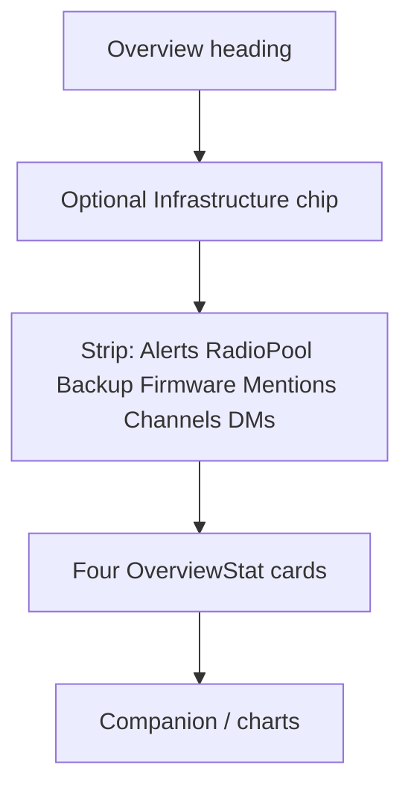

# Overview KPI strip + colored stats

## Locked decisions

- **Channel / Direct KPIs = all-time stored message totals** (`kind = 'channel'` / `kind = 'direct'`), matching “totals.” Mentions stays **unread** (`total_unread_mentions`).
- Mentions leaves the big 5-column grid and joins the compact strip with Alerts / Radio pool / Backup / Firmware.
- Top grid becomes four `OverviewStat` cards with tone-tinted shells (not just value color).

## Layout

In [`src/ui/mod.rs`](src/ui/mod.rs) `DashboardPage`:

1. **Strip** (~1597–1641): keep existing four buttons; append three more that navigate to `Page::Messages`:
   - Mentions — value `total_unread_mentions()`, hint unread / clear
   - Channels — all-time channel message count
   - Direct — all-time DM message count  
   Same chip pattern as Alerts (icon + label + one-line value). Mentions value uses amber when `> 0`.

2. **Top stats grid** (~1649–1720): remove the Mentions button; change `lg:grid-cols-5` → `lg:grid-cols-4`. Keep Enrolled / Pending signup / GPS coverage / Recent traffic.

## Data

Add thin helpers in [`src/db.rs`](src/db.rs):

- `count_messages_kind(kind: &str) -> Result<i64>` — `SELECT COUNT(*) FROM messages WHERE kind = ?1`
- Optional one-liner unit test alongside existing message count tests

Wire counts once in `DashboardPage` next to the other overview queries.

## Color on top KPI cards

Extend [`OverviewStat`](src/ui/mod.rs) (~2248) so the section shell uses a tone class (e.g. `overview-stat overview-stat-signal`) instead of only coloring the number.

In [`assets/form.css`](assets/form.css) (frozen Tailwind cannot do arbitrary tints reliably):

- `.overview-stat` — base card
- `.overview-stat-signal` / `-pending` / `-ok` / `-muted` — soft background wash + 2–3px left accent border using existing palette (`#3dd68c`, amber, sky, muted border)

Keep sparklines and `+N /hr` as they are.

## Verify

- `cargo check` clean
- Visual: strip wraps cleanly on narrow widths; Mentions no longer in the big grid; four colored stats visible
