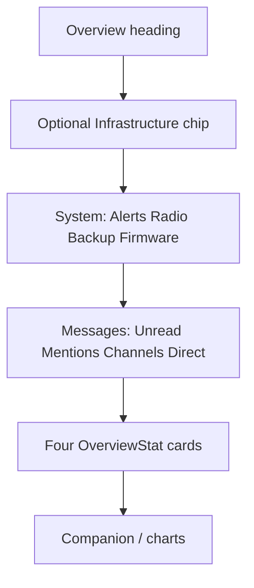

# Overview KPI strip + colored stats

## Shipped decisions

- **Channels / Direct chips** = all-time stored message totals (`count_messages_kind`).
- **Unread** = `total_channel_unread` + `total_dm_unread`.
- **Mentions** = unread HQ `@` mentions (`total_unread_mentions`).
- Strip is **two rows** (not one wrapping flex) so chips stay even width:
  1. Alerts · Radio pool · Backup · Firmware
  2. Unread · Mentions · Channels · Direct
- Top grid = four tinted `OverviewStat` cards (Enrolled / Pending signup / GPS / Recent traffic).
- Whole-card clicks (no text links): strip chips and stats navigate to Inbox / Settings / Messages / Roster / Map as appropriate.
- **Sonar pulse** when live: Unread (`unread > 0`), Mentions (`mention unread > 0`), Direct (`dm unread > 0`). Rose / orange / blue accents. Respects `prefers-reduced-motion`.

## Layout

## Data / CSS

- [`src/db.rs`](src/db.rs): `count_messages_kind(kind)`
- [`src/ui/mod.rs`](src/ui/mod.rs): `DashboardPage` chip stack + `OverviewStat` `onclick`
- [`assets/form.css`](assets/form.css): `.overview-chip-*`, `.overview-stat-*`, `*-live` sonar keyframes

## Verify

- `cargo check` clean; `count_messages_kind_totals` test passes
- Visual: 4+4 even rows; Unread/Mentions/Direct pulse only when counts are live
