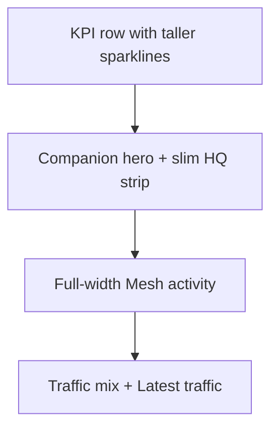

# Overview polish and mention pills

Two focused UX upgrades: make Overview feel less like equal stacked cards, and make channel `@[device]` replies scannable as pills.

## 1. Overview visual hierarchy ([src/ui/mod.rs](src/ui/mod.rs) `DashboardPage`)

Current layout treats KPIs, Companion, HQ, Signup queue, and charts as equal cards. Reorder and reweight:

Concrete layout changes:

- **KPI row:** Keep the four stats. Raise sparkline height (~40px). Show a small “last hour” delta under the value when the last bucket is non-zero (e.g. `+12 /hr`).
- **Companion as hero:** Give the Companion card a connected accent (thin signal-green left edge / border). Keep battery spark + uptime. Move Connect/Disconnect + saved-companion controls into a tighter footer.
- **HQ secondary:** Shrink Headquarters to a compact identity strip (name + On air / Standby + links), not a peer of Companion.
- **Empty Signup queue:** When pending is 0, replace the large card with a one-line chip/row (“Inbox clear”) linking to Inbox; only expand the full queue card when `pending_count > 0`.
- **Mesh activity:** Full width under the hero band (not equal half next to Signup). Dual-series chart gets area fills, a baseline, and four hour labels (`12a · 6a · 12p · now`) derived from the hourly bucket starts.
- **Traffic mix + Latest traffic:** Side-by-side on large screens; mix shows known kinds (`channel` / `direct` / `advert`) even at 0 so a single bar does not float in empty space.

Page atmosphere: subtle page background gradient via existing theme vars / inline style on the Overview root (`#0c0f12` → `#12171c`). No purple glow, glass stacks, or repeater RF metrics.

## 2. Chart widget upgrades ([src/ui/widgets.rs](src/ui/widgets.rs))

- `Sparkline`: taller default viewBox (~120×40), slightly stronger fill opacity.
- `LineChart`: optional area fill under each series; accept `labels: Vec<String>` for bottom ticks; keep empty state as “No data yet”.
- `BarMix`: always receive the three HQ kinds with zero-fill from Overview so empty kinds still list.

Hourly zero-fill stays as-is in DB; the visual fix is fills + ticks + hierarchy, not changing aggregation.

## 3. Mention pills in channel chat ([src/ui/mod.rs](src/ui/mod.rs) `MessageBody` / `linkify_text`)

Mentions are plain text today (`@[Lost In Irvine 2]`). Extend parsing:

- Add `TextPart::Mention(String)` (display name without `@[]` wrappers).
- Parse MeshCore form `@[name]` (name may include spaces). Also accept bare `@Name` when the token has no spaces (for older/local text).
- Render mentions as inline pills: compact rounded chip, signal-green border/text on inbound bubbles, sky-tinted chip on outbound blue bubbles (pass a `outgoing: bool` into `MessageBody`).
- Keep links working: run mention split then linkify on remaining text segments (or a single scanner that emits Text / Link / Mention in order).

Wire storage unchanged — still send `@[name]` on the mesh; only the renderer changes.

## Out of scope

Overview motion systems beyond a simple Connected badge pulse if trivial; battery dual-series (mV); clickable mentions that open roster; repeater RF metrics.
