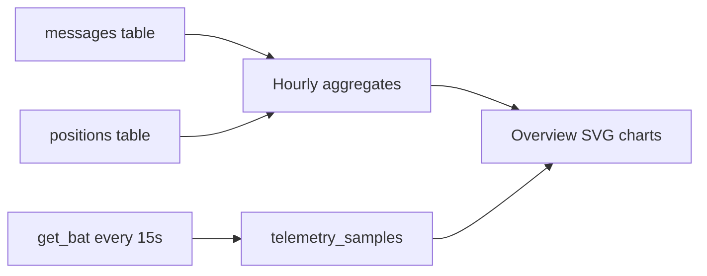

# Overview traffic and device graphs

Reuse the **visual language** from the repeater console (KPI + sparkline, one activity chart, one distribution chart). Feed charts only from HQ data we already own or can sample: `messages`, `positions`, and companion battery polls. Do **not** add noise floor / forward / dropped / duty cycle.

## Data layer ([src/db.rs](src/db.rs))

Add query helpers (single place, used by Overview):

- `traffic_hourly(hours: i64) -> Vec<{ hour_start, rx, tx }>` — `GROUP BY` hour on `received_at`, split by `direction`
- `traffic_kind_counts(since: i64) -> Vec<{ kind, count }>` — `channel` / `direct` / `advert` (and any other kinds)
- `active_senders_hourly(hours)` — distinct `sender_pubkey` per hour (for Enrolled-card sparkline)
- `position_updates_hourly(hours)` — counts from `positions.at` (for GPS-card sparkline)
- `messages_hourly(hours)` — total messages per hour (Recent traffic sparkline)

New table `telemetry_samples`:

- `id`, `kind` (`battery`), `value_mv`, `value_pct`, `at`
- Index on `(kind, at)`
- `insert_telemetry_sample` + `telemetry_series(kind, since) -> Vec<(at, pct)>`
- Include samples in existing purge path so retention still applies

Defaults: last **24 hours**, **24 hourly buckets** (zero-fill missing hours in Rust so charts are continuous).

## Live companion sampling ([src/radio.rs](src/radio.rs))

On each successful `get_bat` (connect + 15s poll in `apply_battery` / poll site):

- Write a `telemetry_samples` row (`battery`, mv, pct, now)
- Add `connected_since: Option<i64>` on `RadioStatus` (set on successful session start, clear on disconnect) for a small “Up Xm” hint on the companion card

## Chart widgets ([src/ui/widgets.rs](src/ui/widgets.rs))

Lightweight SVG only (no chart crate):

- `Sparkline { values: Vec<f32>, tone }` — fill+stroke path in a fixed ~80×28 viewBox
- `LineChart { series: Vec<(label, color, values)>, height }` — dual series for RX/TX, simple axes (no grid clutter)
- `BarMix { rows: Vec<(label, count, tone)> }` — horizontal bars for kind mix

Empty series → muted “No data yet” placeholder, not a blank card.

## Overview UI ([src/ui/mod.rs](src/ui/mod.rs) `DashboardPage` / `OverviewStat`)

1. Extend `OverviewStat` with optional `series: Vec<f32>`; render sparkline under the value.
2. Wire series:
   - **Enrolled** → active senders / hour
   - **Pending signup** → inbound `direct` messages / hour (signup pressure proxy; value stays pending count)
   - **GPS coverage** → position updates / hour
   - **Recent traffic** → show **24h message count** as the big number; sparkline = messages / hour
3. New row under the companion/HQ grid (or beside Latest traffic):
   - **Mesh activity (24h)** — dual-line RX vs TX from `traffic_hourly`
   - **Traffic mix** — bar mix of kinds over 24h
4. On **Companion radio** card: small **Battery (24h)** sparkline from `telemetry_series`, plus connected-uptime text when `connected_since` is set.

Refresh: Overview already re-reads DB each render; battery series updates as polls land. No new tick required beyond existing radio status polling / page navigation.

## Out of scope

Repeater metrics (noise floor, forward, dropped, duty cycle), full MeshCore packet taxonomy bars, and third-party chart libraries.
