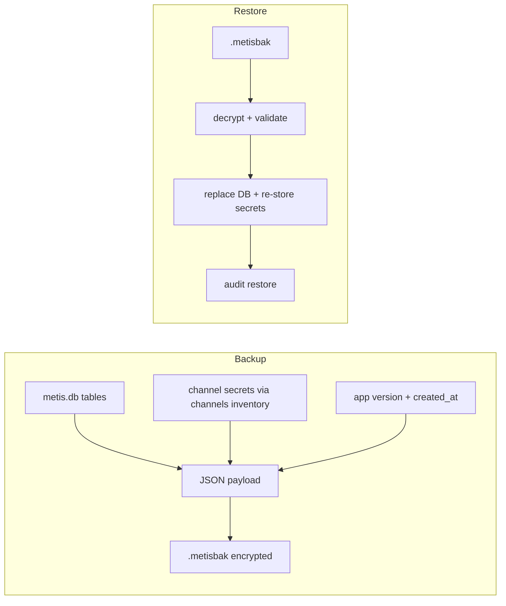

# Phase E — Backup, restore, contact import/export

## Scope

**In this plan:** E1 backup/restore, E2 contact export, E3 contact import.  
**Deferred:** E4 map uploader — HQ holds no MeshCore private keys today; signing uploads would need a separate radio/key-export track (after Phase F USB/multi-radio is a better home).

## Defaults (locked)

- Backup file: `.metisbak` — Argon2id + ChaCha20-Poly1305 envelope around a versioned JSON payload (not a cleartext zip).
- Restore: **replace** HQ state after confirm (disaster recovery), not merge.
- Contacts: versioned JSON array; merge-by-pubkey into SQLite only; never auto-add to the radio contact table.
- UI: Settings section beside existing purge, same Dialog + preview pattern.



---

## E1 — Encrypted backup / restore

### Payload (`format: "metis-hq-backup"`, `version: 1`)

Include:
- Full logical dump of SQLite tables needed for a working HQ (at minimum: `settings`, `nodes`, `channels`, `messages`, `radios`, `paths`, `positions`, `tracked_nodes`, `telemetry_samples`, `rf_samples`, `outbound`, `audit`, `service_events`, `bot_handled`) — implement as SQL dump or row JSON; prefer **sqlite backup API / file copy of a consistent checkpoint** inside the encrypted blob for fidelity.
- `secrets`: map `channel_name → 32-char hex` for every **private** row in `channels`, loaded via existing [`Secrets::load`](src/secrets.rs) (channel table is the inventory; keyring has no list API).
- Metadata: HQ name, created_at (unix), app version string.

Exclude from backup:
- Live BLE PIN
- Regenerable `data/qr/*.svg` (re-enqueue QR worker after restore)
- Map tile packs on disk (path stays in settings; operator re-points if missing)

### Crypto module

New [`src/backup.rs`](src/backup.rs):
- Derive key with Argon2id (salt random per file)
- Encrypt payload with ChaCha20-Poly1305
- File header: magic `METISHQ1`, salt, nonce, ciphertext
- `create_backup(db, secrets, passphrase, out_path)` / `restore_backup(..., passphrase)`
- Add crates: `argon2`, `chacha20poly1305`, `rand` (already present)

### Restore procedure

1. Operator picks file + enters passphrase (wrong passphrase → clear error, no partial write).
2. Dialog preview: node count, message count, channel count, backup timestamp (same pattern as purge in [`src/ui/mod.rs`](src/ui/mod.rs)).
3. On confirm: stop writing (best-effort note if radio connected), write new DB to temp, atomic replace `data/metis.db`, re-`Secrets::store` each channel secret into current store (keyring or file), `ensure_defaults`, audit `restore`.
4. Restart-sensitive state: reload UI signals / toast “Restart recommended if radio was connected.”

### Settings UI

New “Backup” block under Settings (near purge):
- **Create backup…** → passphrase twice → native save dialog / write under `data/backups/`
- **Restore…** → open file → passphrase → preview Dialog → Danger confirm

---

## E2 — Contact bulk export

New helpers in [`src/contact_export.rs`](src/contact_export.rs) (or under `contact_qr` sibling):

```json
{
  "format": "metis-hq-contacts",
  "version": 1,
  "exported_at": 1730...,
  "contacts": [
    {
      "public_key": "...",
      "name": "...",
      "type": 1,
      "lat": 34.1,
      "lon": -117.3,
      "enrollment": "enrolled",
      "last_heard": 1730...
    }
  ]
}
```

- Source: `Db::list_nodes` (+ lat/lon when valid, not 0,0).
- Also emit optional companion file of one `meshcore://contact/add` URI per line for phone-app pastes (same fields as [`contact_add_uri`](src/contact_qr.rs)).
- **No** secrets, hop paths, or private keys.
- Settings: **Export contacts…** writes JSON (and optionally `.txt` URI list).

---

## E3 — Contact bulk import

- Parse `metis-hq-contacts` v1 (reject unknown format; ignore unknown fields).
- For each contact: upsert into `nodes` by pubkey (update name/type; set lat/lon only if valid; preserve stronger enrollment if already enrolled unless import says enrolled).
- **Do not** call radio add-contact / push to companion table.
- After import: enqueue QR generation for new/updated pubkeys.
- Preview Dialog: N new / N updated / N skipped; audit `contacts_import`.
- Settings: **Import contacts…**

---

## Tests

- Round-trip backup encrypt/decrypt with wrong passphrase failure.
- Secrets present in payload for a private channel; restore writes them back (file-only `Secrets` in tests).
- Contact export → import merge-by-pubkey; enrollment not downgraded; no radio APIs invoked.
- `cargo test` clean (no warnings).

---

## Out of scope (this plan)

- E4 map.meshcore.dev uploader and companion private-key export
- Cleartext zip backups
- Merging two live HQs’ message histories on restore
- Auto-push imported contacts onto the radio
