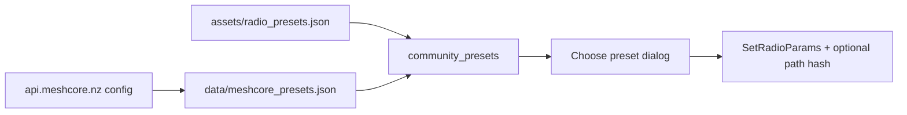

# Device presets, padding, and remaining prefs

## Context

Your radio is on **927.875 MHz** (shown as Custom). That matches the official MeshCore preset **USA - Southern California** from [`https://api.meshcore.nz/api/v1/config`](https://api.meshcore.nz/api/v1/config) ([docs](https://docs.meshcore.io/radio_presets/)). HQ’s baked-in [`assets/radio_presets.json`](assets/radio_presets.json) only has 9 entries and **omits SoCal**, so the picker cannot name your mesh.

Official API currently has **27** presets including `USA` (910.525) and `USA - Southern California` (927.875 / SF7 / BW62.5 / CR5 / path_hash 3). There is no separate “California” / “Northern California” title in that feed—mainland USA uses the USA entry; SoCal is the regional override.

## 1. Device settings padding

Card already uses `p-4`, but Device sub-tab content feels edge-tight (your screenshot).

- Add a Device panel wrapper class in [`assets/form.css`](assets/form.css) (e.g. `.device-settings-panel` with horizontal padding + gap) around Device sub-tab content in [`src/ui/mod.rs`](src/ui/mod.rs).
- Slightly increase Radio card inner spacing (field grid gap / section margins).
- Rebuild picks this up via boot `include_str!` of `form.css` in [`src/main.rs`](src/main.rs).

## 2. Full community presets (SoCal + rest)

**Source of truth:** MeshCore App API `GET https://api.meshcore.nz/api/v1/config` → `config.suggested_radio_settings.entries`, with optional `network_settings.path_hash_size` ([Radio Presets docs](https://docs.meshcore.io/radio_presets/)).

**Approach:**

1. Replace [`assets/radio_presets.json`](assets/radio_presets.json) with a **full snapshot** of the current API list (all 27 titles, including SoCal), plus `path_hash_size` when present. Extend [`RadioPreset`](src/radio_presets.rs) with optional `path_hash_size: Option<u8>` and parse API field names (`title`/`frequency`/…).
2. On Settings Device → Radio open (or app start once), attempt a background fetch of the API with User-Agent `MetisMeshHQ/0.1`, write to `data/meshcore_presets.json` on success, then UI reads **cache if fresh/present else bundled**. Offline HQ keeps working.
3. Preset apply: `set_radio_params(...)` as today; if preset has `path_hash_size`, also `set_custom_var` for the path-hash key when known, else store intent and set after vars refresh / via Network helpers.
4. Matching label: SoCal 927.875 should show **USA - Southern California**, not Custom.
5. Prefer **dropdowns** for BW / SF / CR (MeshCore-like: BW 62.5/125/250, SF 5–12, CR 5–8) while Frequency stays numeric—reduces typos next to presets.

## 3. Remaining first-class Device prefs

From companion [`NodePrefs.h`](https://github.com/meshcore-dev/MeshCore/blob/main/examples/companion_radio/NodePrefs.h) + Advanced custom vars:

**Identity**
- Share position control: map `adv_loc_policy` (0 none / 1 share) to a checkbox or select; write via the companion mechanism already used for similar prefs (custom var if that is how the board exposes it after Refresh, else document as read-only until opcode exists). Prefer toggling known keys (`gps.advert` / loc policy style) discovered from `get_custom_vars` on connected companions.
- GPS on/off (+ interval if present) when custom vars expose `gps` / `gps_enabled` / `gps_interval`—friendly toggles on Identity, not only Advanced.

**Network**
- Always show path-hash size controls (0/1/2 → 1/2/3-byte) writing `path.hash.mode` / `path_hash_mode` / `hash_mode` when any of those keys exist; when applying a SoCal/Canada-style preset with `path_hash_size: 3`, apply that value automatically.

Keep Advanced as the escape hatch for everything else (buzzer, telemetry modes, airtime, etc.).

## Out of scope

- Tools nav (Rx log, noise floor, coverage).
- Import/export / factory reset / in-app CLI.
- Changing BLE radio-param frame format (already working).

## Files

- [`assets/radio_presets.json`](assets/radio_presets.json) — full API snapshot  
- [`src/radio_presets.rs`](src/radio_presets.rs) — API schema + load cache/bundled + fetch helper  
- [`src/ui/mod.rs`](src/ui/mod.rs) — padding wrapper, preset UI, Identity/Network toggles, BW/SF/CR selects  
- [`assets/form.css`](assets/form.css) — device panel padding  
- [`src/radio.rs`](src/radio.rs) — only if new cmds needed beyond existing `set_custom_var` / `set_radio_params`
