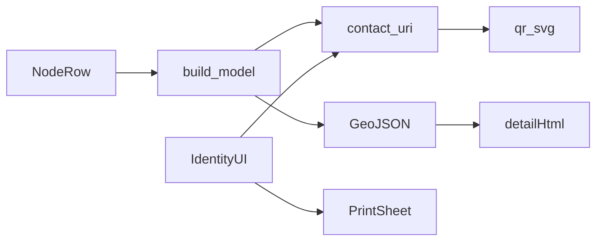

# Contact QR, pin details, per-channel keep

## Why you do not see an HQ QR today

It was never implemented. Device Settings → Identity only shows the public key as hex ([`src/ui/mod.rs`](src/ui/mod.rs) ~3333). Map pin popups also have no QR. Official MeshCore contact format:

`meshcore://contact/add?name=…&public_key=…&type=N`  
(`1` companion / HQ, `2` repeater, `3` room, `4` sensor)

No channel-secret QR in this work (secrets stay operator-gated).

## 1. Shared contact URI + QR helper

Add a small module (e.g. [`src/contact_qr.rs`](src/contact_qr.rs)):

- `contact_add_uri(name, pubkey_hex, contact_type) -> String`
- `qr_svg_data_url(uri) -> String` via the `qrcode` crate (SVG → `data:image/svg+xml;…`)

HQ / companion pins use `type=1`. Heard nodes use their stored `contact_type`.

## 2. HQ Identity: show + print your QR

In Device Settings → **Identity** ([`src/ui/mod.rs`](src/ui/mod.rs) Public info card), under the public key:

- Render the QR image when `radio.public_key` is present
- Buttons: **Copy link** (`meshcore://contact/add…`), **Print**

**Print:** desktop `eval` opens a minimal print document (HQ name, QR, full pubkey, short note) and calls `window.print()` — OS print / Save as PDF. No new window chrome beyond that sheet.

Also surface the same QR when the **HQ map pin** is opened (same URI).

## 3. Map pin detail: more fields + QR

Extend GeoJSON props in [`src/ui/map_page.rs`](src/ui/map_page.rs) `build_model` from `NodeRow` (+ light lookups):

| Field | Source |
| --- | --- |
| Hops | `path_len` / hop_bytes via existing path helpers |
| Prefix | `node.prefix` |
| Last advert | `last_advert` (relative label) |
| Last RF | latest `rf_samples` for that pubkey when present (noise / RSSI / SNR) |
| `contact_uri` + optional `qr_data_url` | shared helper |

Update [`assets/map_bridge.js`](assets/map_bridge.js) `detailHtml`: two-column layout — left rows (existing + new), right QR; actions: Favorite, Copy link. Skip empty RF/hops rows.

## 4. Per-channel message keep (overrides global default)

**Today:** one setting `message_keep`; [`apply_message_keep`](src/db.rs) deletes all messages older than that cutoff.

**Change:**

- Migrate `channels`: `ALTER TABLE … ADD COLUMN message_keep TEXT` (NULL = use global default). Same pattern as visibility/role migrations in [`src/db.rs`](src/db.rs).
- Extend `ChannelRow` + `list_channels` / setters: `channel_message_keep(name) -> Option<String>`, `set_channel_message_keep(name, keep | null)`.
- Rewrite `apply_message_keep`:
  - For each active channel: cutoff from `COALESCE(channel.message_keep, global)`; delete `kind='channel' AND channel_idx=slot AND received_at < cutoff` (skip if forever).
  - DMs / non-channel rows: global keep only.
- Relabel Channels page top card to **Default keep** (still the system default). Keep the Settings retention control as the same global default.
- On **each channel card** (footer next to visibility/delete): dropdown `Use default` | `1h` | `6h` | `24h` | `7d` | `30d` | `Forever`. Changing it writes the column and runs `apply_message_keep`.
- In the **open channel** header/toolbar: same dropdown so operators can change without leaving the thread.

Product copy: “Overrides the default keep for this channel only. Roster, secrets, and audit stay.”

## 5. Files (primary)

- New: [`src/contact_qr.rs`](src/contact_qr.rs); wire in [`src/main.rs`](src/main.rs) / lib module tree
- [`Cargo.toml`](Cargo.toml) — `qrcode` (+ `image` only if needed; prefer SVG-only)
- [`src/db.rs`](src/db.rs) — channel `message_keep`, apply rewrite
- [`src/ui/mod.rs`](src/ui/mod.rs) — Identity QR/print; Channels default label; per-channel selects; open-channel select
- [`src/ui/map_page.rs`](src/ui/map_page.rs) — richer props
- [`assets/map_bridge.js`](assets/map_bridge.js) — detail layout + QR + copy link
- Light CSS for detail QR / print sheet (existing map/popup styles)

## Out of scope

- Channel QR that embeds secrets
- Remote battery/firmware on heard nodes
- Bridge / multi-HQ share of QRs
