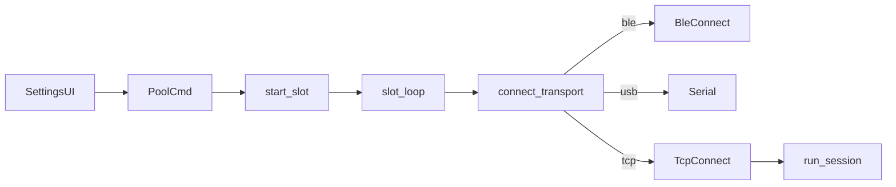

# TCP companion transport (Wi-Fi / Ethernet)

## Scope

One new transport value: **`tcp`**. MeshCore Wi-Fi companions and Ethernet companions both expose the same framed companion protocol over TCP (default port **5000**). Manual host + port in Settings; no mDNS and no BLE Wi-Fi credential wizard in this pass (operators can still set `wifi.*` over an existing BLE/USB CLI link).

Session pipeline after connect stays unchanged (`slot_loop` → appstart → contacts → drain → subscribe).



## 1. Enable crate TCP

In [`Cargo.toml`](Cargo.toml):

```toml
meshcore-rs = { version = "0.2", default-features = false, features = ["ble", "serial", "tcp"] }
```

Also ensure Tokio has what `TcpStream` needs (usually already covered by `rt-multi-thread`; add `net` if compile requires it).

## 2. Connect path in radio pool

Extend [`connect_transport`](src/radio.rs) (~1965):

- `"tcp"` → parse address as `host:port` (default port `5000` if omitted) → `MeshCore::tcp(host, port).await`
- Clear errors for refused / unreachable / timeout

Mirror USB wiring:

- `PoolCmd::ConnectTcp(String)` (+ optional label)
- `RadioHandle::connect_tcp(address)`
- `pool_loop` → `start_slot("tcp", address, label)`
- `reconnect_saved`: if `row.transport == "tcp"`, reconnect by saved address (no BLE scan, no PIN)
- No `ble_pair::force_disconnect` on TCP teardown

Helper (small module or `radio.rs` fns): `normalize_tcp_address`, `parse_tcp_address` → `(host, port)` with validation (non-empty host, port 1–65535).

Store in SQLite as today: `transport = "tcp"`, `address = "192.168.1.50:5000"` (UNIQUE with transport).

## 3. Settings UI + badges

Settings → HQ → Connect ([`src/ui/mod.rs`](src/ui/mod.rs)): add a **Network** card beside USB / Bluetooth:

- Host text field + Port (default `5000`)
- **Connect** → `connect_tcp`
- Short copy: Wi-Fi or Ethernet companion on the LAN; same MeshCore protocol as BLE/USB

Update transport chrome everywhere it hard-codes BLE/USB:

- [`transport_icon` / `transport_label`](src/ui/mod.rs) → TCP / Network
- Pool badges (`USB` / `BLE` → add `TCP` or `Wi-Fi`)
- Overview companion chip
- [`RadioStatus.transport`](src/radio.rs) comment: `ble` | `usb` | `tcp`

Optional icon: reuse `IconName::Signal` or add a simple network glyph if none fits.

## 4. Docs / todo / stack rule

- [`todo.md`](todo.md): add **F6** TCP companion (Wi-Fi / Ethernet), host:port, default 5000; note Ethernet shares this path
- [`.cursor/rules/stack.mdc`](.cursor/rules/stack.mdc): radio access via BLE, USB, and TCP (Wi-Fi/Ethernet companions)
- [`.cursor/rules/radio.mdc`](.cursor/rules/radio.mdc): one Tokio task per companion still; TCP has no PIN; reconnect by host:port

## 5. Verify

- Unit tests for `parse_tcp_address` / normalize (host only → `:5000`, invalid port rejected)
- `cargo check` with `tcp` feature; no warnings
- Manual smoke when hardware available: TCP connect → SelfInfo → contacts; disconnect/reconnect; primary companion still TX

## Out of scope (this pass)

- mDNS / LAN discovery of companions
- In-app Wi-Fi SSID/password wizard (CLI over BLE/USB remains)
- Changing repeater/room TCP CLI ports (23 / other) — those are not companion protocol
