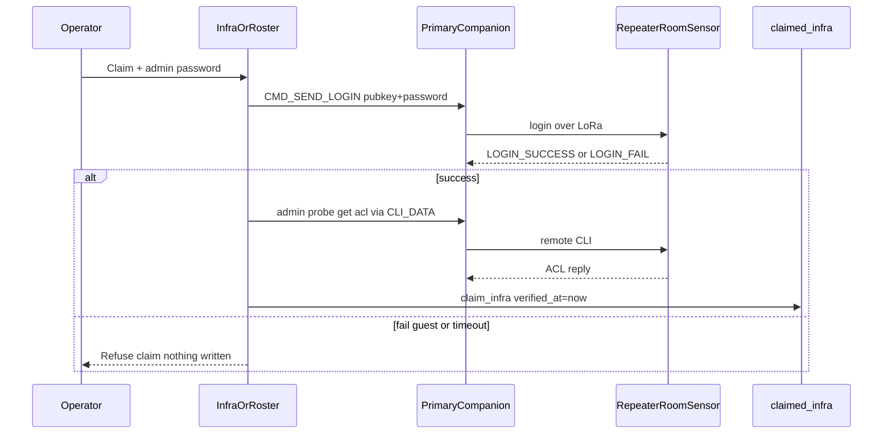

# Verify-on-claim for Infrastructure

## Goal

Operators can only **Claim** a repeater/room/sensor after HQ proves **admin** access over LoRa through the primary companion. No USB required. Passwords are never stored in SQLite. Verified claims then support status probes and remote admin CLI.

## Auth model (why no stored password still gets stats)

MeshCore does **not** send the password on every stats or CLI command.

1. **Password = login only.** `CMD_SEND_LOGIN` proves the password once. On success the **repeater stores HQ’s companion pubkey on its ACL** (admin level after our admin probe).
2. **Stats and admin CLI after that** are authorized by that ACL entry. Status probe (`ver` / `get radio` / `neighbors`) and Remote CLI go out as encrypted CLI_DATA from the same companion — **no password in those packets**.
3. **Re-enter password only when ACL is gone** — e.g. repeater reboot that wipes ACL, ACL LRU eviction, or a different companion/primary radio (different pubkey). UI then shows Verify / re-login; claim row stays; password still not written to SQLite.
4. **Guest password must not claim.** Guest ACL can allow some read-only stats; we refuse Claim unless the post-login admin probe (`get acl`) succeeds so “claimed” means full admin, not tourist read access.

So: password gates **Claim (and rare re-login)**; day-to-day stats/admin use the **ACL grant on the node**, not a saved secret in HQ.

## Protocol facts (already in deps)

- [`meshcore-rs`](https://github.com/meshcore-dev/MeshCore/wiki/Companion-Radio-Protocol) `CommandHandler::send_login(dest, password)` → opcode **26**, needs full **32-byte** pubkey; password max **15** bytes.
- Async result: `EventType::LoginSuccess` (0x85) / `LoginFailed` (0x86). HQ does **not** subscribe to these today in [`src/radio.rs`](src/radio.rs).
- Successful login puts the **companion’s pubkey** on the node ACL. Guest password also yields LoginSuccess — so Claim must require an **admin** proof after login, not LoginSuccess alone.
- Repeater/room admin CLI after ACL login uses `TXT_TYPE_CLI_DATA` (**1**). HQ’s [`apply_remote_cli`](src/radio.rs) currently sends type **3** (`CLI_COMMAND`), which is the companion-remote path. Verified infra admin/stats will use type **1**.

## 1. Radio: login + admin-capable remote CLI

In [`src/radio.rs`](src/radio.rs):

- Add `RadioCmd::SendLogin { pubkey_hex, password, reply }` (primary-only, same as other TX).
- `RadioHandle::login_infra(pubkey, password) -> oneshot::Receiver<Result<(), String>>`:
  - Parse full 32-byte pubkey (reject prefix-only).
  - Truncate/validate password ≤15 bytes; reject empty with a clear error (blank ACL re-login can be a separate “Re-verify with blank” later if already ACL’d — v1 requires typed password).
  - `send_login`, then wait for `LoginSuccess` / `LoginFailed` / timeout (~25s). Subscribe those event types on the session event filter if missing.
  - Do **not** push the password into `cli_line`, status detail, audit, or logs — only `"login ok"` / `"login failed"` / timeout.
- After LoginSuccess, run one **admin** probe: remote text with `txt_type=1` command `get acl` (or equivalent admin-only get). Guest should not return ACL. Timeout or denial → overall login API returns Err `"Admin password required (guest or unread ACL)."` so Claim stays closed.
- Add `apply_remote_cli_data` (txt_type **1**) and route claimed-infra / post-login admin CLI through it. Keep type **3** for Device CLI “companion remote” targets if still needed.
- Optional thin helper: `RadioHandle::run_infra_cli(pubkey, text)` → type 1 path used by Infrastructure page probes/admin.

## 2. DB: verified claims only

In [`src/db.rs`](src/db.rs) `claimed_infra`:

- Add `verified_at INTEGER NOT NULL DEFAULT 0` (migration `CREATE IF NOT EXISTS` + `ALTER` for existing DBs).
- `claim_infra` gains a verified path only: callers pass after RF success; set `verified_at = unix_now()`. Do **not** insert from Roster/Infra without that path.
- Add `mark_claimed_verified` / keep single `claim_infra_verified(...)` used exclusively by the verify UI flow.
- Rows with `verified_at == 0` (pre-change claims): treat as **unverified** — show Re-verify; **block** probe/CLI until success updates `verified_at`. Do not silently delete.
- Still **never** store passwords in SQLite. Notes stay free-text (“church roof”), not secrets.
- Tests: claim without verify helper unused; `claim_infra_verified` sets `verified_at`; unclaim still works.

## 3. UI: Claim dialog fails closed

[`src/ui/infra_page.rs`](src/ui/infra_page.rs) + Roster Claim in [`src/ui/mod.rs`](src/ui/mod.rs):

- Replace one-click Claim with a dialog: target name/prefix, admin password field (`type=password`, maxlength 15), Require primary companion linked.
- On Submit: disable button → `login_infra` → on Ok call `claim_infra_verified` → toast success; on Err show message, **no DB write**.
- Unverified existing cards: badge “Unverified”; primary action “Verify admin…” (same dialog); probe/CLI disabled until verified.
- After verified: Status probe + Remote CLI use infra CLI path (type 1). Before probe/admin CLI, if the node rejects (no ACL), prompt password re-login (updates session; does not unclaim). Still no password persistence.
- Copy: Claim = verified HQ-owned infrastructure; random heard nodes cannot be bookmarked without admin password.

## 4. Stats / admin after claim

- Keep rate-limited status probe (`ver`, `get radio`, `neighbors`) on verified detail, via type-1 CLI after ACL is warm (login on claim already populated ACL).
- Remote CLI presets remain; destructive confirm unchanged.
- Document in UI that admin session lives on the **repeater ACL** for this companion pubkey; repeater reboot/ACL eviction may require Verify/login again.

## 5. Docs + verify

- [`todo.md`](todo.md) Phase I: add **I5** verify-on-claim via `CMD_SEND_LOGIN` + admin ACL proof; passwords not stored.
- `cargo check` + unit tests; manual: wrong password → no claim; admin password → claim + Overview strip; guest password → refused.

## Out of scope

- Persisting repeater passwords in SQLite or git
- USB serial admin console to the repeater firmware
- Separate “Watch” list for unverified interest
- Auto-claim on discover
