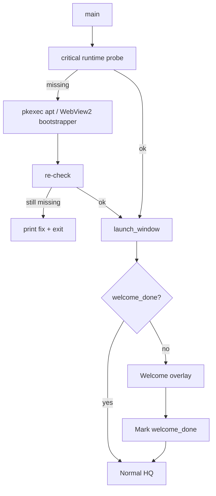

# Welcome setup wizard + About page

## Decisions (locked)

- **Deps:** auto-install where possible (`pkexec` apt on Linux; WebView2 Evergreen bootstrapper on Windows; macOS shows Gatekeeper/WebKit notes only).
- **Companion:** full mini-wizard (BLE scan / USB pick / TCP host) with Skip.
- **About:** as discussed (version, author, MIT, GitHub, data path, short product blurb, key third-party credits).

## Chicken-and-egg note

WebKitGTK / WebView2 are required to draw the Dioxus window. Critical runtime checks run in [`src/main.rs`](src/main.rs) **before** `launch_window()`. Soft checks (BlueZ, `dialout`, flasher CLIs) run inside the welcome UI after the window is up.

## 1. Runtime dependency module — new [`src/deps.rs`](src/deps.rs)

**Critical (pre-UI):**

- **Linux:** probe shared libs / packages for WebKitGTK 4.1 + GTK3 (e.g. `libwebkit2gtk-4.1-0`, `libgtk-3-0`, and related). If missing, run:
  `pkexec apt-get install -y libwebkit2gtk-4.1-0 libgtk-3-0 libayatana-appindicator3-1 libsoup-3.0-0 libjavascriptcoregtk-4.1-0 libdbus-1-3`
  (Debian/Ubuntu only; if not apt-based, print package names and exit).
- **Windows:** detect WebView2 runtime (registry / known path). If missing, download Microsoft Evergreen Bootstrapper to a temp file and run it; wait; re-check.
- **macOS:** no install attempt; if WebKit unavailable, clear stderr message.

**Soft (welcome UI):**

- Linux: `bluetoothd` / BlueZ present; current user in `dialout` (USB serial). Offer:
  - `pkexec apt-get install -y bluez` when BlueZ missing
  - `pkexec usermod -aG dialout $USER` when not in group (then tell operator to log out/in)
- Optional flasher tools: detect `esptool` / `adafruit-nrfutil` — show status + install hint (do not force; flasher is secondary).

Expose: `critical_status()`, `ensure_critical() -> Result<()>`, `soft_status() -> SoftDepsReport`, `install_soft(item) -> Result<String>`.

Wire `ensure_critical()` from [`main`](src/main.rs) before `launch_window()`.

## 2. Welcome wizard UI — overlay on first launch

Setting: `welcome_done` (`""` / `"1"`) in SQLite via existing `Db::setting` / `set_setting`.

In [`src/ui/mod.rs`](src/ui/mod.rs) App root: if `!welcome_done`, show a full-stage modal (blocks nav) with steps:

1. **Welcome** — product one-liner, logo via `brand::default_logo_url()`.
2. **System setup** — run soft-deps report; Install buttons per missing item; Refresh; show last install log/error. Soft-fail continues (operator can Skip).
3. **Companion (optional)** — transport tabs BLE / USB / TCP reusing `RadioHandle` APIs already used by Settings → Connect (`refresh_usb`, scan BLE, `connect_*`). Status line from radio snapshot. Skip allowed.
4. **Done** — set `welcome_done=1`, dismiss to Overview.

Also: **Settings → reopen setup** (small “Run setup again” that clears `welcome_done` or opens the same wizard) so operators are not stuck after Skip.

Keep UI in existing dark HQ style ([`assets/form.css`](assets/form.css)); no new purple/cream themes.

## 3. About page

Add **Settings → About** (new `HqTab::About` or `SettingsTab::About` — prefer Settings top-level tab next to Diagnostics for discoverability).

Content:

| Field | Source |
| --- | --- |
| App name | Metis Mesh HQ |
| Version | `env!("CARGO_PKG_VERSION")` |
| Author | DigitalExpl0it |
| License | MIT ([`Cargo.toml`](Cargo.toml)) |
| Source | https://github.com/digitalexpl0it/MetisMesh-HQ (copyable link chip, same pattern as meshcore:// chips — no shell open unless we already open https safely; prefer copy + show URL) |
| Data folder | `crate::data_dir()` display path + Copy |
| Blurb | Local offline emergency HQ for MeshCore; no cloud account |
| Credits | Dioxus, MapLibre, MeshCore / meshcore-rs (short names only) |

Optional footer on welcome Done step: “About” jumps to Settings → About after dismissing.

## 4. Docs / todo

- README: note first-run wizard + that critical libs may prompt for admin/pkexec.
- [`todo.md`](todo.md): add a short checked item under Phase H or a small Phase K for Welcome/About when done.
- [`CHANGELOG.md`](CHANGELOG.md): Welcome wizard + About.

## Out of scope

- Code signing / notarization.
- Non-apt Linux distros auto-install (show packages only).
- Auto-downloading MeshCore firmware inside welcome (Flasher stays in Settings).
- Migrating old cwd `./data` into profile dir.

## Verify

- Fresh Linux VM / user: missing soft dep → Install prompts pkexec → status updates; Skip still reaches app.
- Windows without WebView2 (if testable): bootstrapper runs before UI or clear failure.
- Welcome companion: connect BLE or USB from wizard; Skip works; `welcome_done` persists across restart.
- About shows correct version, GitHub URL, author, MIT, live data path.
- `cargo test` / `cargo check` clean.
