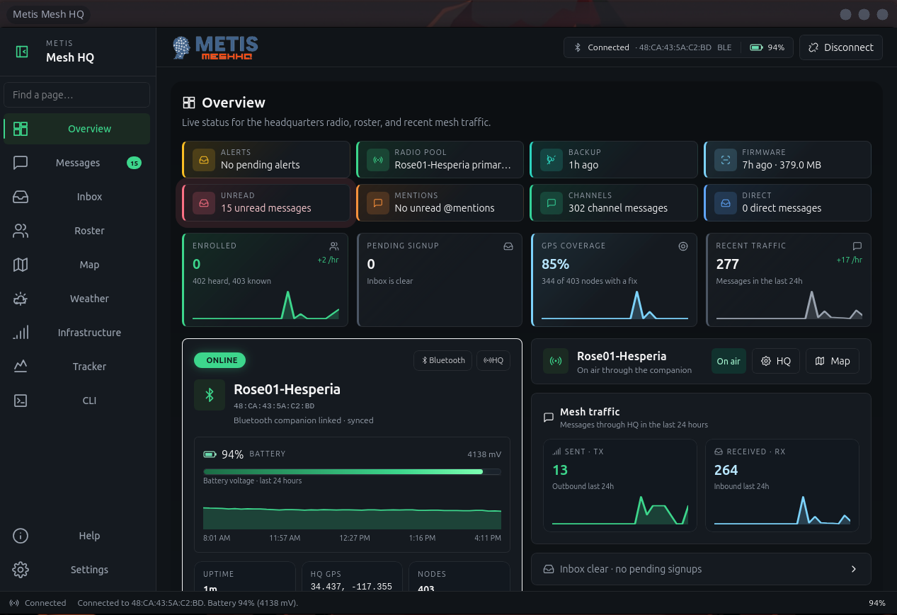

# Metis Mesh HQ

Local emergency headquarters for [MeshCore](https://meshcore.io/) communities.

Churches, neighborhoods, and volunteer groups run this on a regular computer sitting next to a MeshCore companion radio. It keeps working when the internet drops. No cloud account, and it does not call home.



## What it does

- **Radio pool** — connect MeshCore companions over Bluetooth, USB serial, or TCP (Wi-Fi / Ethernet, default port 5000); multiple radios with a primary that owns bot and enrollment traffic
- **Enrollment** — approve join requests, hand out private channel secrets, run the local bot on METIS-INFO (`#weather`, `#quake`, `#amber`, and related commands)
- **Messages** — Channels / DMs / Contacts rail; public and private channels with session speakers under each channel; direct threads only when a public key is known (contact card / companion contact); unread and @mention tracking; optional per-channel look; block senders (including by channel display name); share via `meshcore://contact/add` and `meshcore://channel/add` chips
- **Inbox** — pending signups and held community alerts (weather / Amber / civil) for operator confirm or auto-relay
- **Roster** — everyone heard on the mesh (enrolled or not); contact QR; clear NEW / prune heard-only
- **Map** — MapLibre with a local style (optional PMTiles offline packs); live pins, message sonar, tracked movers; operator path **Trace** (tracked/claimed) and passive **Traffic** edges
- **Overview** — companion status + activity; **Repeaters** tab when infrastructure is claimed (fleet tiles, detail window 15m–7d, Battery/Queue Chart·Gauge·Numeric)
- **Weather** — Open-Meteo and local stations (MQTT / Ecowitt); operator Weather page plus mesh bot replies
- **Infrastructure** — claim and admin-verify repeaters, rooms, and sensors; probe and remote CLI through the primary companion
- **Tracker** — whitelist of devices expected to share GPS; trails and stale styling on the map
- **CLI** — companion and remote device console for operators
- **Firmware locker** — mirror community firmware while online; flash over USB on the HQ machine when the internet is gone (Ready-for-outage, checksums, export/import pack). Optional **LAN flash locker** (Settings → Flasher): HTTPS + room PIN so other laptops download synced builds and flash via Web Serial (ESP SLIP / nRF DFU zip), plus OTAFIX UF2 downloads, Enter DFU, Custom local files, and Repeater/Room setup CLI
- **Backup** — passphrase-encrypted HQ archive (SQLite + channel secrets); restore with confirm
- **Local-first storage** — SQLite under the per-user data folder; channel secrets in the OS keyring when possible (otherwise a locked-down file)
- **Help** — in-app operator guide, shareable radio-user signup steps, and the full offline runbook (Settings → About links here; `docs/OFFLINE_RUNBOOK.md` mirrors Help for GitHub)

Communities stay separate until both headquarters agree to link. That bridge is not in this MVP yet — the data model leaves room for it.

## Install (standalone binary)

Supported release targets are **Windows** (`x86_64`) and **Linux** (`x86_64`). macOS is not shipped. Each GitHub Release (and `main` Actions artifacts) includes:

| Artifact | Use when |
|---|---|
| **Windows** `.zip` | Windows 10/11 |
| **Ubuntu 26.04** `.deb` | Ubuntu 26.04+ (`dpkg -i` / apt) |
| **Linux** `.tar.gz` | Unpack-and-run on Ubuntu 26.04+ (install runtime libs below) |
| **Linux** `.AppImage` | Portable — Fedora, Arch, Debian, older Ubuntu, etc. |

1. Download from a [GitHub Release](https://github.com/digitalexpl0it/MetisMesh-HQ/releases) (preferred), or from the Actions tab on `main`.
2. Install / run:
   - **Ubuntu `.deb`:** `sudo apt install ./metis-mesh-hq_*_amd64.deb` (or `sudo dpkg -i …` then `sudo apt -f install`)
   - **Linux AppImage:** `chmod +x metis-mesh-hq-x86_64.AppImage && ./metis-mesh-hq-x86_64.AppImage`
   - **Linux tarball:** unpack, then `./metis-mesh-hq` (keep `assets/` beside it)
   - **Windows:** unpack the zip, then run `metis-mesh-hq-windows-x86_64.exe`
3. First launch creates the per-user data folder (SQLite, firmware cache, backups, QR files):
   - Linux: `~/.MetisMeshHQ`
   - Windows: `%APPDATA%\MetisMeshHQ`
   
   Override with `METIS_DATA_DIR=/path/to/dir` if you want the data elsewhere.

   The live store is `metis.db` (WAL mode) plus optional `metis.db-wal` and `metis.db-shm` beside it. Prefer **Settings → Backup** for copies. If you copy the data folder by hand, include all three files — or stop HQ first so SQLite can checkpoint into `metis.db`.

4. First launch opens a **setup wizard**: checks Bluetooth / USB serial access, can install missing pieces (may prompt for admin / `pkexec`), and optionally connects a companion (BLE / USB / TCP). You can skip and finish later under Settings → Connect. Settings → About has version, license, GitHub, and data-folder path; **Run setup again** reopens the wizard.

### Runtime libraries

Critical UI libraries are probed before the window opens. On Debian/Ubuntu the app will try `pkexec apt-get install` for WebKitGTK/GTK if they are missing; on Windows it can download the WebView2 Evergreen bootstrapper. You can still install manually:

- **Ubuntu `.deb`:** Depends pulls WebKit/GTK. You still want **BlueZ** for Bluetooth and membership in `dialout` for USB serial (log out/in after the wizard adds you).
- **Linux AppImage:** GTK/WebKit libraries **and** WebKit helper processes travel inside the image (`WEBKIT_EXEC_PATH`). Host still needs **BlueZ** and `dialout` (or equivalent).
- **Linux tarball (Ubuntu 26.04+):**

  ```bash
  sudo apt-get update
  sudo apt-get install -y \
    libwebkit2gtk-4.1-0 libgtk-3-0t64 \
    libayatana-appindicator3-1 libsoup-3.0-0 \
    libjavascriptcoregtk-4.1-0 libdbus-1-3
  ```

- **Windows:** Edge WebView2 runtime (usually already present on current Windows 10/11). If missing, HQ downloads the Evergreen bootstrapper with PowerShell and runs a silent install. Optional flashers (`esptool`, `adafruit-nrfutil`) install the same way (winget Python if needed, then `pip --user`).

### Publishing a GitHub Release

Releases are created only from version tags (not every `main` push):

```bash
git tag v0.1.15
git push origin v0.1.15
```

That attaches the Windows `.zip`, Ubuntu `.deb`, Linux `.tar.gz`, and Linux `.AppImage`. If the tag already exists on an older commit, move it after the release commit (`git tag -f v0.1.15` then `git push --force origin v0.1.15`) or use the next patch version.

## Requirements (build from source)

- Rust (1.88+ is fine; we build on stable)
- [Dioxus CLI](https://dioxuslabs.com/) (`dx`) for day-to-day runs
- A MeshCore companion radio nearby
- On Linux: WebKitGTK 4.1, GTK 3, D-Bus, and libudev headers (see below)

### Linux packages (Ubuntu 26.04+)

Supported Linux baseline is **Ubuntu 26.04** (and newer). Build deps:

```bash
sudo apt-get update
sudo apt-get install -y \
  build-essential pkg-config \
  libwebkit2gtk-4.1-dev libgtk-3-dev \
  libayatana-appindicator3-dev libxdo-dev \
  libsoup-3.0-dev libjavascriptcoregtk-4.1-dev \
  libdbus-1-dev libudev-dev
```

Bluetooth needs BlueZ running. Disconnect the MeshCore phone app before HQ connects over BLE — the companion only allows one GATT client. USB and TCP do not use a companion PIN.

## Run it

```bash
cargo install dioxus-cli   # once
dx serve --platform desktop
```

Or:

```bash
cargo run --release
```

On first launch it creates the per-user data folder (`~/.MetisMeshHQ` on Linux — see Install) for the database and QR cache.

## Build releases yourself

```bash
cargo build --release
```

Binary lands at `target/release/metis-mesh-hq` (`.exe` on Windows). Map scripts/CSS are embedded and served over the `metis` protocol; keep `assets/` next to the binary for any remaining dioxus `asset!()` URLs.

Linux packages (needs a release build first):

```bash
./packaging/linux/build-deb.sh        # Ubuntu 26.04+ .deb
./packaging/linux/build-appimage.sh   # portable AppImage (fetches linuxdeploy once)
```

Desktop window icon uses the mesh-head mark from the brand logo (`assets/app_icon.png`). On Windows builds, `build.rs` / `winres` also embeds that `.ico` plus VERSIONINFO so Explorer **Properties → Details** shows File description, Product name/version, and Copyright (needs a native Windows or properly tooled cross-compile — plain Linux hosts skip embedding with a warning).

## Layout

| Path | What |
| --- | --- |
| `src/` | App, radio task, SQLite, map tiles, UI |
| `assets/` | MapLibre, CSS, presets, offline map bits |
| `Screenshots/` | README product shots |
| profile data dir | Local DB + QR SVGs (`~/.MetisMeshHQ` on Linux; not in git) |
| `.github/workflows/` | Cross-platform builds |

## Notes worth knowing

- Mesh text is plain text, max 160 bytes. Never treat it like a shell or HTML.
- Only enrolled nodes get bot replies or channel secrets.
- GPS from a node is self-reported. An enrolled site pin is separate.
- This is a community tool. It is not FEMA, NWS, or law enforcement.

## License

MIT — see `Cargo.toml`.
